# 3ª Avaliação de Banco de Dados Relacional — Sistema de Tickets (Projeto API)

**FATEC São José dos Campos · BDR · 2º semestre de 2026** · Entrega: 23/11/2026

| | |
|---|---|
| **Tema** | Projeto API 2026.02 (FawkesCode / parceiro Altave): plataforma unificada de tickets / ordens de serviço |
| **SGBD** | MySQL 8.0 (validado no 8.0.40) |
| **Banco** | `bdr_api` |
| **Integrantes** | _preencher_ |

## Arquivos da entrega

| Parte | Conteúdo | Arquivo |
|---|---|---|
| 1 | Modelo conceitual | [`modelos/modelo-conceitual.md`](../modelos/modelo-conceitual.md), [`modelos/modelo-conceitual.png`](../modelos/modelo-conceitual.png) |
| 1 | Modelo lógico | [`modelos/modelo-logico.md`](../modelos/modelo-logico.md), [`modelos/modelo-logico.png`](../modelos/modelo-logico.png) |
| 2 | **Script de criação das tabelas (DDL)** | [`sql/01_ddl.sql`](../sql/01_ddl.sql) |
| 3 | **Script de inserção de dados (DML)** | [`sql/02_dml.sql`](../sql/02_dml.sql) (gerado por [`scripts/gerar_dml.py`](../scripts/gerar_dml.py)) |
| 3 | Views | [`sql/03_views.sql`](../sql/03_views.sql) |
| 3 | 6 functions | [`sql/04_functions.sql`](../sql/04_functions.sql) |
| 3 | 6 stored procedures | [`sql/05_procedures.sql`](../sql/05_procedures.sql) |
| 3 | 6 triggers | [`sql/06_triggers.sql`](../sql/06_triggers.sql) |
| 3 | Execuções de exemplo (prints) | [`sql/07_exemplos.sql`](../sql/07_exemplos.sql), [`docs/prints/`](prints/) |
| 4 | **Dicionário de dados** | [`docs/dicionario-de-dados.md`](dicionario-de-dados.md) |
| 5 | Conexão com a API (sp_abrir_ticket + fn_situacao_sla) | [`docs/parte5.md`](parte5.md), [`scripts/demo_parte5.sh`](../scripts/demo_parte5.sh), [`docs/prints/parte5/`](prints/parte5/) |

### Como executar

```sh
# na pasta do repositório; ajuste usuário/host/porta do seu MySQL 8
MYSQL="mysql -uroot -p -h127.0.0.1 -P3306" ./scripts/rodar_tudo.sh
# equivalente manual, na ordem:
# mysql -uroot -p < sql/01_ddl.sql   (... até 06_triggers.sql)
# depois, opcionalmente, os exemplos:  mysql -uroot -p --force -t < sql/07_exemplos.sql
```

A ordem importa: os triggers (06) são criados **depois** da carga (02) para não interferirem nos dados
históricos. Os scripts recriam o banco do zero (`DROP DATABASE IF EXISTS bdr_api`).

---

## Parte 1 — Modelos de banco de dados

O modelo foi levantado a partir das entidades reais da API (`src/prisma/schema.prisma` e migrations):
`usuarios`, `equipes`, `clientes`, `projetos`, `tickets`, `ticket_equipes`, `relatorios`,
`historico_ticket` e `atividades_conta`. Para o BDR ele foi complementado com três tabelas de domínio
(`cargos`, `prioridades`, `status_ticket`) que normalizam os ENUMs da API e guardam regras de negócio
(SLA padrão por prioridade, permissões por cargo), além de CHECKs e DEFAULTs. Nomes e tipos foram
mantidos idênticos aos da API para a Parte 5.

### 1.1 Modelo conceitual (brModelo / notação de Chen)

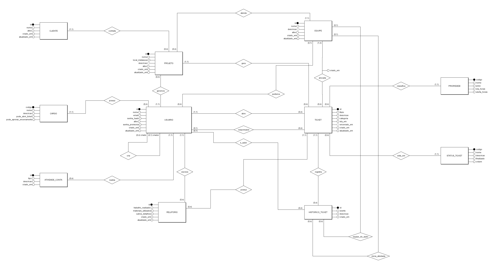

Entidades, atributos, cardinalidades e o passo a passo para redesenhar no brModelo:
[`modelos/modelo-conceitual.md`](../modelos/modelo-conceitual.md).

### 1.2 Modelo lógico

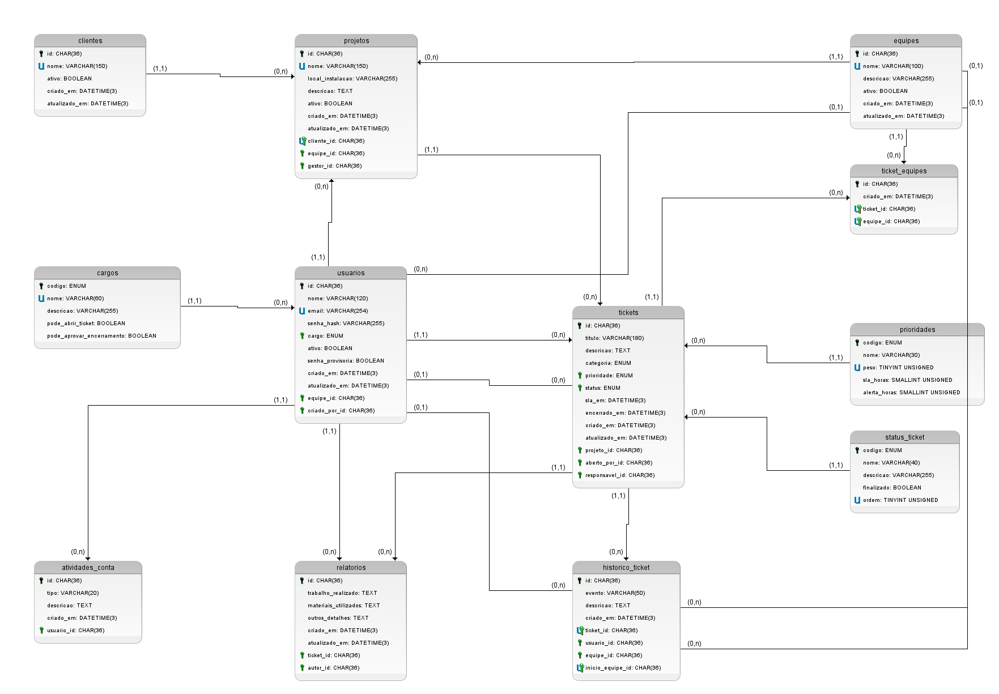

Esquema relacional e decisões de mapeamento: [`modelos/modelo-logico.md`](../modelos/modelo-logico.md).

---

## Parte 2 — Criação das tabelas (DDL)

Script: [`sql/01_ddl.sql`](../sql/01_ddl.sql). Cria o banco `bdr_api` com 12 tabelas, todas com PK,
e com 20 FKs, UNIQUEs (`email`, nome de equipe/cliente, projeto por cliente, equipe por ticket, um início
de atividade por equipe), CHECKs (ex.: `encerrado_em` só existe quando o ticket está ENCERRADO; o SLA
precisa ser posterior à abertura) e DEFAULTs (UUID, datas automáticas, status/prioridade padrão).

| Tabela | Tipo | Registros |
|---|---|---|
| `cargos` | domínio | 5 |
| `prioridades` | domínio | 4 |
| `status_ticket` | domínio | 5 |
| `equipes` | | 50 |
| `usuarios` | | 223 |
| `clientes` | | 50 |
| `projetos` | | 60 |
| `tickets` | | 220 |
| `ticket_equipes` | associativa N:N | 304 |
| `relatorios` | | 426 |
| `historico_ticket` | | 1374 |
| `atividades_conta` | | 702 |

## Parte 3 — Inserção das linhas (DML)

Script: [`sql/02_dml.sql`](../sql/02_dml.sql) — um `INSERT INTO` por linha, dentro de uma transação.
Os dados são fictícios e foram gerados por [`scripts/gerar_dml.py`](../scripts/gerar_dml.py) com semente
fixa, então o arquivo é sempre o mesmo. Os dados respeitam as FKs e as regras do negócio: cada equipe tem
1 gestor e 3 técnicos; projetos ligados a clientes, equipes e ao gestor da equipe; tickets com status
coerente com a idade (antigos encerrados, recentes em andamento); SLA pela prioridade; cerca de 25 %
dos encerramentos fora do SLA; histórico em ordem cronológica (abertura → início por equipe → relatórios
→ solicitação → aprovação/negação). Apenas as tabelas de domínio têm menos de 50 registros, como o
enunciado permite.

## Parte 3 — Programação em banco de dados

### Visão geral

| # | Rotina | Problema resolvido |
|---|---|---|
| F1 | `fn_calcular_sla_em` | Calcula a data-limite do SLA pela prioridade (SLA padrão na tabela `prioridades`). |
| F2 | `fn_situacao_sla` | Indicador de SLA do ticket: NO_PRAZO, EM_ALERTA, VENCIDO, CUMPRIDO ou VIOLADO (US 5). **API** |
| F3 | `fn_percentual_sla_consumido` | % do prazo do SLA já consumido (barra de progresso). |
| F4 | `fn_tempo_medio_resolucao_equipe` | Tempo médio (h) de resolução dos tickets de uma equipe. |
| F5 | `fn_taxa_cumprimento_sla_equipe` | % de tickets encerrados dentro do SLA por equipe e período. |
| F6 | `fn_sugerir_tecnico` | Sugere o técnico ativo menos carregado da equipe. |
| P1 | `sp_abrir_ticket` | Abre ticket de forma atômica com validações, SLA, equipe, técnico, histórico e auditoria (US 1/8). **API** |
| P2 | `sp_decidir_encerramento` | Gestor aprova/nega o encerramento com parecer, com trava de linha. **API** |
| P3 | `sp_desativar_tecnico_redistribuir` | Desativa técnico e redistribui seus tickets abertos (cursor) (US 23). |
| P4 | `sp_gerar_alertas_sla` | Gera alertas de SLA para os gestores, sem repetir em 24 h (cursor) (US 19). |
| P5 | `sp_relatorio_sla_equipes` | Relatório gerencial de SLA e tempo de resolução por equipe no período. |
| P6 | `sp_ranking_tecnicos` | Ranking de produtividade dos técnicos vs. média da equipe. |
| T1 | `trg_tickets_bi_validar` | Valida abertura (projeto/cliente/usuário ativos) e calcula SLA se não informado. |
| T2 | `trg_tickets_bu_fluxo_status` | Bloqueia alteração de ticket encerrado e transições de status inválidas; preenche `encerrado_em`. |
| T3 | `trg_tickets_au_historico` | Registra no histórico mudanças de status, responsável e SLA. |
| T4 | `trg_relatorios_bi_validar_autor` | Só técnico ativo de equipe alocada registra relatório; nunca em ticket encerrado. |
| T5 | `trg_relatorios_ai_inicio_atividade` | 1º relatório da equipe registra o início da atividade e põe o ticket EM_ANDAMENTO. |
| T6 | `trg_usuarios_au_auditoria` | Audita ativação, cargo, equipe e senha das contas (US 20/23/24). |

**Conceitos usados no conjunto:**

| Conceito | Onde |
|---|---|
| CURSOR | `sp_desativar_tecnico_redistribuir`, `sp_gerar_alertas_sla` |
| VIEW | `vw_tickets_detalhados`, `vw_carga_equipes`, `vw_produtividade_tecnicos` (usadas em `sp_abrir_ticket`, `sp_gerar_alertas_sla`, `sp_ranking_tecnicos` e nos exemplos) |
| INNER JOIN | views, `fn_tempo_medio_resolucao_equipe`, `sp_abrir_ticket`, `sp_desativar_tecnico_redistribuir`, `trg_tickets_bi_validar`, `trg_relatorios_bi_validar_autor` |
| LEFT JOIN | `vw_tickets_detalhados`, `vw_carga_equipes`, `fn_sugerir_tecnico`, `sp_relatorio_sla_equipes`, `sp_ranking_tecnicos` |
| RIGHT JOIN | `vw_produtividade_tecnicos`, `sp_ranking_tecnicos` |
| GROUP BY / HAVING | `vw_carga_equipes`, `vw_produtividade_tecnicos`, `fn_sugerir_tecnico`, `sp_gerar_alertas_sla`, `sp_relatorio_sla_equipes` (HAVING), `sp_ranking_tecnicos` |
| Funções de grupo | `COUNT`, `SUM`, `AVG`, `MAX`, `GROUP_CONCAT` (views, F4, F5, F6, P4, P5, P6) |
| Subconsultas | escalar (`fn_situacao_sla`, `vw_carga_equipes`, P5), `IN` (`fn_taxa_cumprimento_sla_equipe`), `EXISTS`/`NOT EXISTS` (P2, P4, T4, T5), correlacionada (`fn_sugerir_tecnico`), tabela derivada (P6) |
| Transação / tratamento de erro | `START TRANSACTION`/`COMMIT`, `EXIT HANDLER ... ROLLBACK; RESIGNAL`, `SIGNAL SQLSTATE '45000'`, `SELECT ... FOR UPDATE` |

**Pensadas para a Parte 5 (API):** a function `fn_situacao_sla` (indicador de SLA da US 5) e as procedures
`sp_abrir_ticket` (US 1/8) e `sp_decidir_encerramento` (fluxo de aprovação de encerramento).

### Views de apoio

```sql
-- ---------------------------------------------------------------------
-- vw_tickets_detalhados
-- Fila de tickets "pronta para tela": junta ticket, projeto, cliente,
-- equipe do projeto, quem abriu (INNER JOIN) e responsável (LEFT JOIN,
-- pois o ticket pode não ter responsável). Traz o peso da prioridade
-- (para ordenar a fila) e as horas que faltam para o SLA.
-- ---------------------------------------------------------------------
CREATE OR REPLACE VIEW vw_tickets_detalhados AS
SELECT t.id                    AS ticket_id,
       t.titulo,
       t.categoria,
       t.prioridade,
       pr.peso                 AS peso_prioridade,
       t.status,
       st.finalizado,
       t.criado_em,
       t.sla_em,
       t.encerrado_em,
       ROUND(TIMESTAMPDIFF(MINUTE, NOW(), t.sla_em) / 60, 1) AS horas_para_sla,
       p.id                    AS projeto_id,
       p.nome                  AS projeto,
       c.nome                  AS cliente,
       e.id                    AS equipe_id,
       e.nome                  AS equipe_projeto,
       g.nome                  AS gestor,
       g.email                 AS email_gestor,
       ab.nome                 AS aberto_por,
       r.id                    AS responsavel_id,
       r.nome                  AS responsavel
FROM tickets t
INNER JOIN prioridades   pr ON pr.codigo = t.prioridade
INNER JOIN status_ticket st ON st.codigo = t.status
INNER JOIN projetos      p  ON p.id  = t.projeto_id
INNER JOIN clientes      c  ON c.id  = p.cliente_id
INNER JOIN equipes       e  ON e.id  = p.equipe_id
INNER JOIN usuarios      g  ON g.id  = p.gestor_id
INNER JOIN usuarios      ab ON ab.id = t.aberto_por_id
LEFT  JOIN usuarios      r  ON r.id  = t.responsavel_id;

-- ---------------------------------------------------------------------
-- vw_carga_equipes
-- Quantos tickets cada equipe tem alocados, por situação. Usa LEFT JOIN
-- para listar também equipes sem nenhum ticket, GROUP BY e funções de
-- grupo (COUNT/SUM) e uma subconsulta escalar para contar técnicos ativos.
-- ---------------------------------------------------------------------
CREATE OR REPLACE VIEW vw_carga_equipes AS
SELECT e.id   AS equipe_id,
       e.nome AS equipe,
       e.ativo,
       (SELECT COUNT(*) FROM usuarios u
         WHERE u.equipe_id = e.id AND u.cargo = 'TECNICO' AND u.ativo) AS tecnicos_ativos,
       COUNT(t.id)                                          AS total_tickets,
       COALESCE(SUM(t.status <> 'ENCERRADO'), 0)            AS tickets_abertos,
       COALESCE(SUM(t.status <> 'ENCERRADO' AND t.sla_em < NOW()), 0) AS abertos_sla_vencido,
       COALESCE(SUM(t.status = 'ENCERRADO'), 0)             AS tickets_encerrados
FROM equipes e
LEFT JOIN ticket_equipes te ON te.equipe_id = e.id
LEFT JOIN tickets        t  ON t.id = te.ticket_id
GROUP BY e.id, e.nome, e.ativo;

-- ---------------------------------------------------------------------
-- vw_produtividade_tecnicos
-- Produção de cada técnico: relatórios escritos, tickets atendidos e
-- tickets dos quais é responsável. RIGHT JOIN a partir de usuarios para
-- manter técnicos que ainda não escreveram nenhum relatório.
-- ---------------------------------------------------------------------
CREATE OR REPLACE VIEW vw_produtividade_tecnicos AS
SELECT u.id                               AS tecnico_id,
       u.nome                             AS tecnico,
       u.ativo,
       e.nome                             AS equipe,
       COUNT(rel.id)                      AS relatorios,
       COUNT(DISTINCT rel.ticket_id)      AS tickets_atendidos,
       MAX(rel.criado_em)                 AS ultimo_relatorio,
       (SELECT COUNT(*) FROM tickets t
         WHERE t.responsavel_id = u.id AND t.status <> 'ENCERRADO') AS tickets_abertos_responsavel
FROM relatorios rel
RIGHT JOIN usuarios u ON u.id = rel.autor_id
LEFT  JOIN equipes  e ON e.id = u.equipe_id
WHERE u.cargo = 'TECNICO'
GROUP BY u.id, u.nome, u.ativo, e.nome;
```

### 3.1 Functions

### F1. fn_calcular_sla_em(prioridade, data_base)

**Problema.** Na API o prazo do SLA é escolhido "na mão" no formulário. O banco passa a ter o SLA padrão de cada prioridade (tabela prioridades) e esta função devolve a data-limite a partir de uma data base (abertura do ticket). Usada pelo trigger de INSERT de tickets e pela procedure de abertura.

**Código SQL** (`sql/04_functions.sql`):

```sql
CREATE FUNCTION fn_calcular_sla_em(p_prioridade VARCHAR(10), p_base DATETIME(3))
RETURNS DATETIME(3)
READS SQL DATA
BEGIN
  DECLARE v_horas SMALLINT;
  DECLARE CONTINUE HANDLER FOR NOT FOUND BEGIN END;  -- SELECT INTO sem linha => NULL

  SELECT sla_horas INTO v_horas
    FROM prioridades
   WHERE codigo = p_prioridade;

  IF v_horas IS NULL THEN
    SIGNAL SQLSTATE '45000'
      SET MESSAGE_TEXT = 'Prioridade inválida: não há SLA cadastrado.';
  END IF;

  RETURN DATE_ADD(COALESCE(p_base, NOW(3)), INTERVAL v_horas HOUR);
END
```

**Execução de exemplo** (bloco `-- @print F1_fn_calcular_sla_em` de `sql/07_exemplos.sql`):

```sql
USE bdr_api;
SELECT codigo AS prioridade, sla_horas,
       fn_calcular_sla_em(codigo, '2026-11-23 08:00:00') AS sla_para_abertura_23_11_08h
  FROM prioridades ORDER BY peso;
SELECT fn_calcular_sla_em('URGENTE', NOW());
```

**Retorno obtido** — print: [`docs/prints/F1_fn_calcular_sla_em.png`](prints/F1_fn_calcular_sla_em.png)

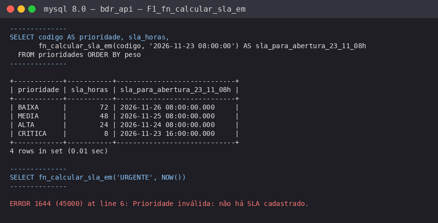

<details><summary>Saída em texto</summary>

```text
--------------
SELECT codigo AS prioridade, sla_horas,
       fn_calcular_sla_em(codigo, '2026-11-23 08:00:00') AS sla_para_abertura_23_11_08h
  FROM prioridades ORDER BY peso
--------------

+------------+-----------+-----------------------------+
| prioridade | sla_horas | sla_para_abertura_23_11_08h |
+------------+-----------+-----------------------------+
| BAIXA      |        72 | 2026-11-26 08:00:00.000     |
| MEDIA      |        48 | 2026-11-25 08:00:00.000     |
| ALTA       |        24 | 2026-11-24 08:00:00.000     |
| CRITICA    |         8 | 2026-11-23 16:00:00.000     |
+------------+-----------+-----------------------------+
4 rows in set (0.00 sec)

--------------
SELECT fn_calcular_sla_em('URGENTE', NOW())
--------------

ERROR 1644 (45000) at line 6: Prioridade inválida: não há SLA cadastrado.
```
</details>

### F2. fn_situacao_sla(ticket_id) — *pensada para a API (Parte 5)*

**Problema.** A US 5 pede um indicador visual do SLA em cada ticket. A função classifica o ticket em:
- `CUMPRIDO / VIOLADO` → ticket encerrado dentro / fora do prazo
- `VENCIDO` → aberto e já passou do prazo
- `EM_ALERTA` → aberto e faltam menos que "alerta_horas" da prioridade (subconsulta na tabela prioridades)
- `NO_PRAZO` → aberto e com folga

Retorna NULL se o ticket não existe.

**Código SQL** (`sql/04_functions.sql`):

```sql
CREATE FUNCTION fn_situacao_sla(p_ticket_id CHAR(36))
RETURNS VARCHAR(20)
READS SQL DATA
BEGIN
  DECLARE v_status   VARCHAR(30);
  DECLARE v_sla      DATETIME(3);
  DECLARE v_fim      DATETIME(3);
  DECLARE v_alerta   SMALLINT;
  DECLARE CONTINUE HANDLER FOR NOT FOUND BEGIN END;  -- SELECT INTO sem linha => NULL

  SELECT t.status, t.sla_em, t.encerrado_em,
         (SELECT p.alerta_horas FROM prioridades p WHERE p.codigo = t.prioridade)
    INTO v_status, v_sla, v_fim, v_alerta
    FROM tickets t
   WHERE t.id = p_ticket_id;

  IF v_status IS NULL THEN
    RETURN NULL;
  END IF;

  IF v_status = 'ENCERRADO' THEN
    RETURN IF(v_fim <= v_sla, 'CUMPRIDO', 'VIOLADO');
  ELSEIF NOW(3) > v_sla THEN
    RETURN 'VENCIDO';
  ELSEIF TIMESTAMPDIFF(MINUTE, NOW(3), v_sla) <= v_alerta * 60 THEN
    RETURN 'EM_ALERTA';
  END IF;
  RETURN 'NO_PRAZO';
END
```

**Execução de exemplo** (bloco `-- @print F2_fn_situacao_sla` de `sql/07_exemplos.sql`):

```sql
USE bdr_api;
SELECT fn_situacao_sla(id) AS situacao_sla, COUNT(*) AS tickets
  FROM tickets GROUP BY situacao_sla ORDER BY tickets DESC;
SELECT LEFT(titulo, 45) AS titulo, status, prioridade, sla_em, fn_situacao_sla(id) AS situacao_sla
  FROM tickets WHERE status <> 'ENCERRADO' ORDER BY sla_em LIMIT 8;
```

**Retorno obtido** — print: [`docs/prints/F2_fn_situacao_sla.png`](prints/F2_fn_situacao_sla.png)

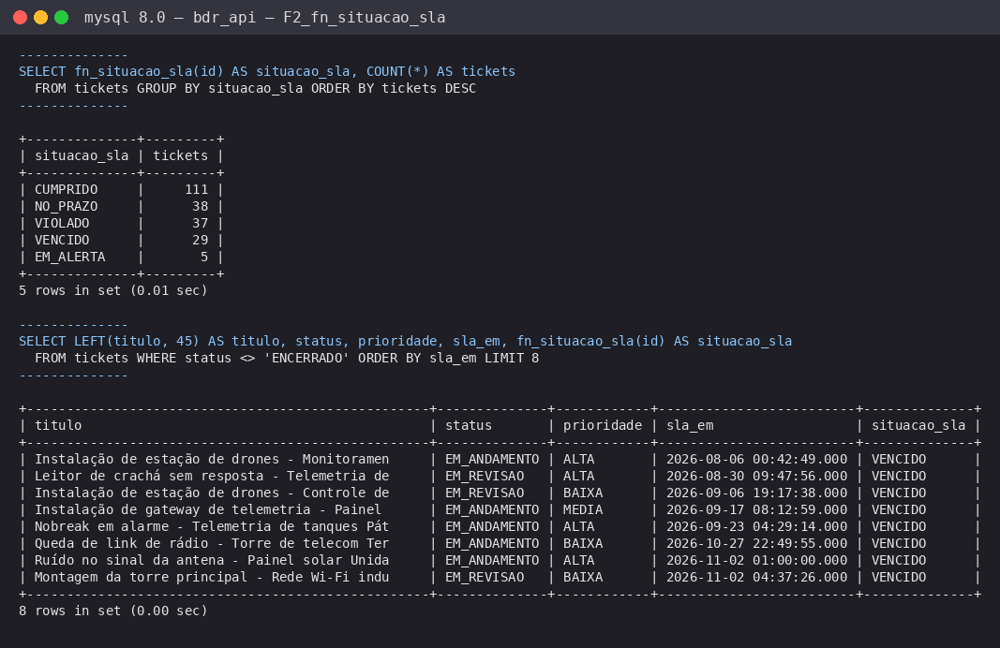

<details><summary>Saída em texto</summary>

```text
--------------
SELECT fn_situacao_sla(id) AS situacao_sla, COUNT(*) AS tickets
  FROM tickets GROUP BY situacao_sla ORDER BY tickets DESC
--------------

+--------------+---------+
| situacao_sla | tickets |
+--------------+---------+
| CUMPRIDO     |     111 |
| NO_PRAZO     |      38 |
| VIOLADO      |      37 |
| VENCIDO      |      29 |
| EM_ALERTA    |       5 |
+--------------+---------+
5 rows in set (0.01 sec)

--------------
SELECT LEFT(titulo, 45) AS titulo, status, prioridade, sla_em, fn_situacao_sla(id) AS situacao_sla
  FROM tickets WHERE status <> 'ENCERRADO' ORDER BY sla_em LIMIT 8
--------------

+---------------------------------------------------+--------------+------------+-------------------------+--------------+
| titulo                                            | status       | prioridade | sla_em                  | situacao_sla |
+---------------------------------------------------+--------------+------------+-------------------------+--------------+
| Instalação de estação de drones - Monitoramen     | EM_ANDAMENTO | ALTA       | 2026-08-06 00:42:49.000 | VENCIDO      |
| Leitor de crachá sem resposta - Telemetria de     | EM_REVISAO   | ALTA       | 2026-08-30 09:47:56.000 | VENCIDO      |
| Instalação de estação de drones - Controle de     | EM_REVISAO   | BAIXA      | 2026-09-06 19:17:38.000 | VENCIDO      |
| Instalação de gateway de telemetria - Painel      | EM_ANDAMENTO | MEDIA      | 2026-09-17 08:12:59.000 | VENCIDO      |
| Nobreak em alarme - Telemetria de tanques Pát     | EM_ANDAMENTO | ALTA       | 2026-09-23 04:29:14.000 | VENCIDO      |
| Queda de link de rádio - Torre de telecom Ter     | EM_ANDAMENTO | BAIXA      | 2026-10-27 22:49:55.000 | VENCIDO      |
| Ruído no sinal da antena - Painel solar Unida     | EM_ANDAMENTO | ALTA       | 2026-11-02 01:00:00.000 | VENCIDO      |
| Montagem da torre principal - Rede Wi-Fi indu     | EM_REVISAO   | BAIXA      | 2026-11-02 04:37:26.000 | VENCIDO      |
+---------------------------------------------------+--------------+------------+-------------------------+--------------+
8 rows in set (0.00 sec)
```
</details>

### F3. fn_percentual_sla_consumido(ticket_id)

**Problema.** Para a barra de progresso do SLA na tela é preciso saber quanto do prazo já foi consumido (0 % na abertura, 100 % no prazo, > 100 % quando estourou). Para tickets encerrados, mede até o encerramento.

**Código SQL** (`sql/04_functions.sql`):

```sql
CREATE FUNCTION fn_percentual_sla_consumido(p_ticket_id CHAR(36))
RETURNS DECIMAL(7,1)
READS SQL DATA
BEGIN
  DECLARE v_criado DATETIME(3);
  DECLARE v_sla    DATETIME(3);
  DECLARE v_ref    DATETIME(3);
  DECLARE CONTINUE HANDLER FOR NOT FOUND BEGIN END;  -- SELECT INTO sem linha => NULL

  SELECT criado_em, sla_em, COALESCE(encerrado_em, NOW(3))
    INTO v_criado, v_sla, v_ref
    FROM tickets
   WHERE id = p_ticket_id;

  IF v_criado IS NULL THEN
    RETURN NULL;
  END IF;

  RETURN ROUND(100 * TIMESTAMPDIFF(SECOND, v_criado, v_ref)
                   / GREATEST(TIMESTAMPDIFF(SECOND, v_criado, v_sla), 1), 1);
END
```

**Execução de exemplo** (bloco `-- @print F3_fn_percentual_sla_consumido` de `sql/07_exemplos.sql`):

```sql
USE bdr_api;
SELECT LEFT(titulo, 45) AS titulo, status, criado_em, sla_em,
       fn_percentual_sla_consumido(id) AS pct_consumido, fn_situacao_sla(id) AS situacao
  FROM tickets WHERE status <> 'ENCERRADO'
 ORDER BY pct_consumido DESC LIMIT 10;
```

**Retorno obtido** — print: [`docs/prints/F3_fn_percentual_sla_consumido.png`](prints/F3_fn_percentual_sla_consumido.png)

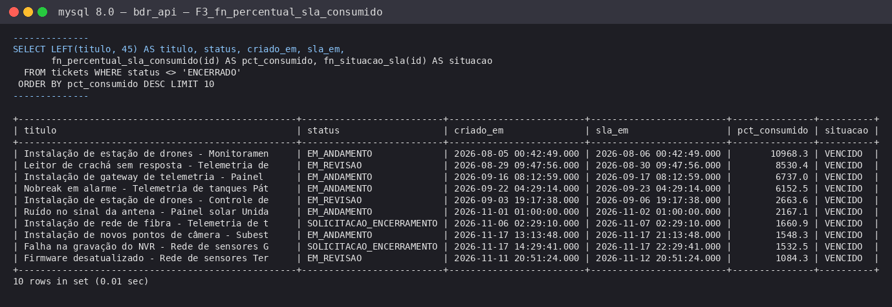

<details><summary>Saída em texto</summary>

```text
--------------
SELECT LEFT(titulo, 45) AS titulo, status, criado_em, sla_em,
       fn_percentual_sla_consumido(id) AS pct_consumido, fn_situacao_sla(id) AS situacao
  FROM tickets WHERE status <> 'ENCERRADO'
 ORDER BY pct_consumido DESC LIMIT 10
--------------

+---------------------------------------------------+--------------------------+-------------------------+-------------------------+---------------+----------+
| titulo                                            | status                   | criado_em               | sla_em                  | pct_consumido | situacao |
+---------------------------------------------------+--------------------------+-------------------------+-------------------------+---------------+----------+
| Instalação de estação de drones - Monitoramen     | EM_ANDAMENTO             | 2026-08-05 00:42:49.000 | 2026-08-06 00:42:49.000 |       10968.7 | VENCIDO  |
| Leitor de crachá sem resposta - Telemetria de     | EM_REVISAO               | 2026-08-29 09:47:56.000 | 2026-08-30 09:47:56.000 |        8530.8 | VENCIDO  |
| Instalação de gateway de telemetria - Painel      | EM_ANDAMENTO             | 2026-09-16 08:12:59.000 | 2026-09-17 08:12:59.000 |        6737.4 | VENCIDO  |
| Nobreak em alarme - Telemetria de tanques Pát     | EM_ANDAMENTO             | 2026-09-22 04:29:14.000 | 2026-09-23 04:29:14.000 |        6152.9 | VENCIDO  |
| Instalação de estação de drones - Controle de     | EM_REVISAO               | 2026-09-03 19:17:38.000 | 2026-09-06 19:17:38.000 |        2663.7 | VENCIDO  |
| Ruído no sinal da antena - Painel solar Unida     | EM_ANDAMENTO             | 2026-11-01 01:00:00.000 | 2026-11-02 01:00:00.000 |        2167.5 | VENCIDO  |
| Instalação de rede de fibra - Telemetria de t     | SOLICITACAO_ENCERRAMENTO | 2026-11-06 02:29:10.000 | 2026-11-07 02:29:10.000 |        1661.3 | VENCIDO  |
| Instalação de novos pontos de câmera - Subest     | EM_ANDAMENTO             | 2026-11-17 13:13:48.000 | 2026-11-17 21:13:48.000 |        1549.5 | VENCIDO  |
| Falha na gravação do NVR - Rede de sensores G     | SOLICITACAO_ENCERRAMENTO | 2026-11-17 14:29:41.000 | 2026-11-17 22:29:41.000 |        1533.7 | VENCIDO  |
| Firmware desatualizado - Rede de sensores Ter     | EM_REVISAO               | 2026-11-11 20:51:24.000 | 2026-11-12 20:51:24.000 |        1084.7 | VENCIDO  |
+---------------------------------------------------+--------------------------+-------------------------+-------------------------+---------------+----------+
10 rows in set (0.01 sec)
```
</details>

### F4. fn_tempo_medio_resolucao_equipe(equipe_id)

**Problema.** A liderança não tem visibilidade de quanto tempo cada equipe leva para resolver um ticket. Calcula a média (AVG) em horas entre a abertura e o encerramento dos tickets ENCERRADOS em que a equipe foi alocada (INNER JOIN tickets x ticket_equipes).

**Código SQL** (`sql/04_functions.sql`):

```sql
CREATE FUNCTION fn_tempo_medio_resolucao_equipe(p_equipe_id CHAR(36))
RETURNS DECIMAL(10,2)
READS SQL DATA
BEGIN
  DECLARE v_media DECIMAL(10,2);

  SELECT ROUND(AVG(TIMESTAMPDIFF(MINUTE, t.criado_em, t.encerrado_em)) / 60, 2)
    INTO v_media
    FROM tickets t
   INNER JOIN ticket_equipes te ON te.ticket_id = t.id
   WHERE te.equipe_id = p_equipe_id
     AND t.status = 'ENCERRADO';

  RETURN v_media;   -- NULL quando a equipe ainda não encerrou tickets
END
```

**Execução de exemplo** (bloco `-- @print F4_fn_tempo_medio_resolucao_equipe` de `sql/07_exemplos.sql`):

```sql
USE bdr_api;
SELECT equipe, tickets_encerrados,
       fn_tempo_medio_resolucao_equipe(equipe_id) AS horas_medias_resolucao
  FROM vw_carga_equipes
 WHERE tickets_encerrados > 0
 ORDER BY horas_medias_resolucao LIMIT 10;
```

**Retorno obtido** — print: [`docs/prints/F4_fn_tempo_medio_resolucao_equipe.png`](prints/F4_fn_tempo_medio_resolucao_equipe.png)

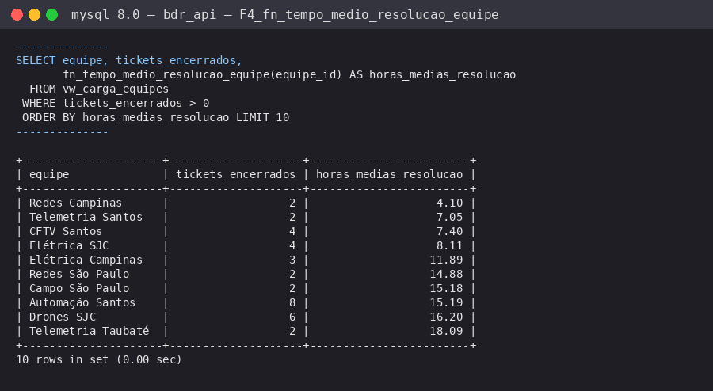

<details><summary>Saída em texto</summary>

```text
--------------
SELECT equipe, tickets_encerrados,
       fn_tempo_medio_resolucao_equipe(equipe_id) AS horas_medias_resolucao
  FROM vw_carga_equipes
 WHERE tickets_encerrados > 0
 ORDER BY horas_medias_resolucao LIMIT 10
--------------

+---------------------+--------------------+------------------------+
| equipe              | tickets_encerrados | horas_medias_resolucao |
+---------------------+--------------------+------------------------+
| Redes Campinas      |                  2 |                   4.10 |
| Telemetria Santos   |                  2 |                   7.05 |
| CFTV Santos         |                  4 |                   7.40 |
| Elétrica SJC        |                  4 |                   8.11 |
| Elétrica Campinas   |                  3 |                  11.89 |
| Redes São Paulo     |                  2 |                  14.88 |
| Campo São Paulo     |                  2 |                  15.18 |
| Automação Santos    |                  8 |                  15.19 |
| Drones SJC          |                  6 |                  16.20 |
| Telemetria Taubaté  |                  2 |                  18.09 |
+---------------------+--------------------+------------------------+
10 rows in set (0.01 sec)
```
</details>

### F5. fn_taxa_cumprimento_sla_equipe(equipe_id, inicio, fim)

**Problema.** Medir o indicador "% de tickets encerrados dentro do SLA" de uma equipe num período (tickets abertos entre inicio e fim). Usa duas subconsultas com funções de grupo (COUNT) sobre os tickets da equipe.

**Código SQL** (`sql/04_functions.sql`):

```sql
CREATE FUNCTION fn_taxa_cumprimento_sla_equipe(p_equipe_id CHAR(36), p_inicio DATE, p_fim DATE)
RETURNS DECIMAL(5,2)
READS SQL DATA
BEGIN
  DECLARE v_total   INT;
  DECLARE v_no_prazo INT;

  SELECT COUNT(*),
         COALESCE(SUM(t.encerrado_em <= t.sla_em), 0)
    INTO v_total, v_no_prazo
    FROM tickets t
   WHERE t.status = 'ENCERRADO'
     AND t.criado_em >= p_inicio
     AND t.criado_em <  DATE_ADD(p_fim, INTERVAL 1 DAY)
     AND t.id IN (SELECT te.ticket_id FROM ticket_equipes te WHERE te.equipe_id = p_equipe_id);

  IF v_total = 0 THEN
    RETURN NULL;
  END IF;
  RETURN ROUND(100 * v_no_prazo / v_total, 2);
END
```

**Execução de exemplo** (bloco `-- @print F5_fn_taxa_cumprimento_sla_equipe` de `sql/07_exemplos.sql`):

```sql
USE bdr_api;
SELECT equipe,
       fn_taxa_cumprimento_sla_equipe(equipe_id, '2026-07-01', '2026-09-30') AS pct_sla_3T,
       fn_taxa_cumprimento_sla_equipe(equipe_id, '2026-10-01', '2026-11-30') AS pct_sla_out_nov
  FROM vw_carga_equipes
 ORDER BY pct_sla_out_nov DESC, equipe LIMIT 12;
```

**Retorno obtido** — print: [`docs/prints/F5_fn_taxa_cumprimento_sla_equipe.png`](prints/F5_fn_taxa_cumprimento_sla_equipe.png)

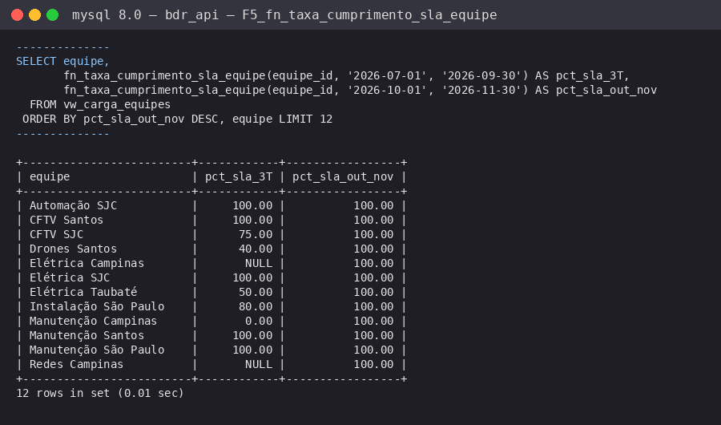

<details><summary>Saída em texto</summary>

```text
--------------
SELECT equipe,
       fn_taxa_cumprimento_sla_equipe(equipe_id, '2026-07-01', '2026-09-30') AS pct_sla_3T,
       fn_taxa_cumprimento_sla_equipe(equipe_id, '2026-10-01', '2026-11-30') AS pct_sla_out_nov
  FROM vw_carga_equipes
 ORDER BY pct_sla_out_nov DESC, equipe LIMIT 12
--------------

+-------------------------+------------+-----------------+
| equipe                  | pct_sla_3T | pct_sla_out_nov |
+-------------------------+------------+-----------------+
| Automação SJC           |     100.00 |          100.00 |
| CFTV Santos             |     100.00 |          100.00 |
| CFTV SJC                |      75.00 |          100.00 |
| Drones Santos           |      40.00 |          100.00 |
| Elétrica Campinas       |       NULL |          100.00 |
| Elétrica SJC            |     100.00 |          100.00 |
| Elétrica Taubaté        |      50.00 |          100.00 |
| Instalação São Paulo    |      80.00 |          100.00 |
| Manutenção Campinas     |       0.00 |          100.00 |
| Manutenção Santos       |     100.00 |          100.00 |
| Manutenção São Paulo    |     100.00 |          100.00 |
| Redes Campinas          |       NULL |          100.00 |
+-------------------------+------------+-----------------+
12 rows in set (0.01 sec)
```
</details>

### F6. fn_sugerir_tecnico(equipe_id)

**Problema.** Ao abrir/redistribuir um ticket o gestor precisa escolher um técnico; a função sugere o técnico ATIVO da equipe com menos tickets abertos sob sua responsabilidade (LEFT JOIN para contar zero, GROUP BY + COUNT). Empate: quem tem menos relatórios nos últimos 7 dias (subconsulta correlacionada). NULL se a equipe não tem técnico ativo.

**Código SQL** (`sql/04_functions.sql`):

```sql
CREATE FUNCTION fn_sugerir_tecnico(p_equipe_id CHAR(36))
RETURNS CHAR(36)
READS SQL DATA
BEGIN
  DECLARE v_tecnico CHAR(36);
  DECLARE CONTINUE HANDLER FOR NOT FOUND BEGIN END;  -- SELECT INTO sem linha => NULL

  SELECT u.id INTO v_tecnico
    FROM usuarios u
    LEFT JOIN tickets t
           ON t.responsavel_id = u.id
          AND t.status <> 'ENCERRADO'
   WHERE u.equipe_id = p_equipe_id
     AND u.cargo = 'TECNICO'
     AND u.ativo = TRUE
   GROUP BY u.id
   ORDER BY COUNT(t.id),
            (SELECT COUNT(*) FROM relatorios r
              WHERE r.autor_id = u.id
                AND r.criado_em >= NOW(3) - INTERVAL 7 DAY),
            u.id
   LIMIT 1;

  RETURN v_tecnico;
END
```

**Execução de exemplo** (bloco `-- @print F6_fn_sugerir_tecnico` de `sql/07_exemplos.sql`):

```sql
USE bdr_api;
SELECT c.equipe, c.tecnicos_ativos, u.nome AS tecnico_sugerido,
       (SELECT COUNT(*) FROM tickets t
         WHERE t.responsavel_id = u.id AND t.status <> 'ENCERRADO') AS abertos_do_sugerido
  FROM vw_carga_equipes c
  LEFT JOIN usuarios u ON u.id = fn_sugerir_tecnico(c.equipe_id)
 ORDER BY c.tickets_abertos DESC LIMIT 10;
```

**Retorno obtido** — print: [`docs/prints/F6_fn_sugerir_tecnico.png`](prints/F6_fn_sugerir_tecnico.png)

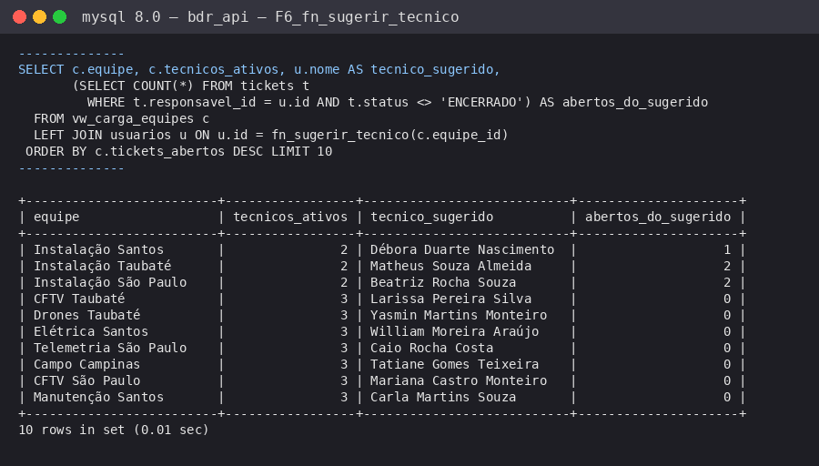

<details><summary>Saída em texto</summary>

```text
--------------
SELECT c.equipe, c.tecnicos_ativos, u.nome AS tecnico_sugerido,
       (SELECT COUNT(*) FROM tickets t
         WHERE t.responsavel_id = u.id AND t.status <> 'ENCERRADO') AS abertos_do_sugerido
  FROM vw_carga_equipes c
  LEFT JOIN usuarios u ON u.id = fn_sugerir_tecnico(c.equipe_id)
 ORDER BY c.tickets_abertos DESC LIMIT 10
--------------

+-------------------------+-----------------+---------------------------+---------------------+
| equipe                  | tecnicos_ativos | tecnico_sugerido          | abertos_do_sugerido |
+-------------------------+-----------------+---------------------------+---------------------+
| Instalação Santos       |               2 | Débora Duarte Nascimento  |                   1 |
| Instalação Taubaté      |               2 | Matheus Souza Almeida     |                   2 |
| Instalação São Paulo    |               2 | Beatriz Rocha Souza       |                   2 |
| CFTV Taubaté            |               3 | Larissa Pereira Silva     |                   0 |
| Drones Taubaté          |               3 | Yasmin Martins Monteiro   |                   0 |
| Elétrica Santos         |               3 | William Moreira Araújo    |                   0 |
| Telemetria São Paulo    |               3 | Caio Rocha Costa          |                   0 |
| Campo Campinas          |               3 | Tatiane Gomes Teixeira    |                   0 |
| CFTV São Paulo          |               3 | Mariana Castro Monteiro   |                   0 |
| Manutenção Santos       |               3 | Carla Martins Souza       |                   0 |
+-------------------------+-----------------+---------------------------+---------------------+
10 rows in set (0.01 sec)
```
</details>


### 3.2 Stored procedures

### P1. sp_abrir_ticket(...) — *pensada para a API (Parte 5)*

**Problema.** Abrir um ticket envolve várias gravações que precisam ser atômicas (US 1 e 8): o ticket, a alocação da equipe do projeto, o histórico e a atividade da conta. A procedure valida as regras de negócio (usuário ativo e com cargo que pode abrir ticket, projeto e cliente ativos, categoria/prioridade válidas), calcula o SLA pela prioridade quando não é informado (fn_calcular_sla_em) - a API envia a data-limite escolhida no formulário (slaEm) -, sugere o técnico responsável (fn_sugerir_tecnico) e grava tudo numa transação. Devolve o id no parâmetro OUT e o ticket criado (vw_tickets_detalhados).

**Código SQL** (`sql/05_procedures.sql`):

```sql
CREATE PROCEDURE sp_abrir_ticket(
  IN  p_projeto_id   CHAR(36),
  IN  p_usuario_id   CHAR(36),
  IN  p_titulo       VARCHAR(180),
  IN  p_descricao    TEXT,
  IN  p_categoria    VARCHAR(20),
  IN  p_prioridade   VARCHAR(10),
  IN  p_sla_em       DATETIME(3),   -- prazo escolhido na tela; NULL = SLA padrão da prioridade
  OUT p_ticket_id    CHAR(36))
BEGIN
  DECLARE v_pode_abrir BOOLEAN;
  DECLARE v_ativo      BOOLEAN;
  DECLARE v_eq_usuario CHAR(36);
  DECLARE v_nome_proj  VARCHAR(150);
  DECLARE v_eq_proj    CHAR(36);
  DECLARE v_proj_ok    BOOLEAN;
  DECLARE v_agora      DATETIME(3) DEFAULT NOW(3);
  DECLARE v_sla        DATETIME(3);

  DECLARE EXIT HANDLER FOR SQLEXCEPTION
  BEGIN
    ROLLBACK;
    RESIGNAL;
  END;

  -- usuário + permissão do cargo (INNER JOIN com a tabela de domínio)
  SELECT u.ativo, c.pode_abrir_ticket, u.equipe_id
    INTO v_ativo, v_pode_abrir, v_eq_usuario
    FROM usuarios u
   INNER JOIN cargos c ON c.codigo = u.cargo
   WHERE u.id = p_usuario_id;

  IF v_ativo IS NULL OR v_ativo = FALSE THEN
    SIGNAL SQLSTATE '45000' SET MESSAGE_TEXT = 'Usuário inexistente ou inativo.';
  END IF;
  IF v_pode_abrir = FALSE THEN
    SIGNAL SQLSTATE '45000' SET MESSAGE_TEXT = 'O cargo do usuário não permite abrir tickets.';
  END IF;

  -- projeto e cliente precisam estar ativos
  SELECT p.nome, p.equipe_id, (p.ativo AND c.ativo)
    INTO v_nome_proj, v_eq_proj, v_proj_ok
    FROM projetos p
   INNER JOIN clientes c ON c.id = p.cliente_id
   WHERE p.id = p_projeto_id;

  IF v_proj_ok IS NULL OR v_proj_ok = FALSE THEN
    SIGNAL SQLSTATE '45000' SET MESSAGE_TEXT = 'Projeto inexistente, inativo ou de cliente inativo.';
  END IF;
  IF p_categoria NOT IN ('MANUTENCAO', 'INSTALACAO') THEN
    SIGNAL SQLSTATE '45000' SET MESSAGE_TEXT = 'Categoria inválida (MANUTENCAO ou INSTALACAO).';
  END IF;

  SET p_prioridade = COALESCE(p_prioridade, 'MEDIA');
  SET v_sla = COALESCE(p_sla_em, fn_calcular_sla_em(p_prioridade, v_agora));
  IF v_sla <= v_agora THEN
    SIGNAL SQLSTATE '45000' SET MESSAGE_TEXT = 'O prazo do SLA precisa ser uma data futura.';
  END IF;

  START TRANSACTION;
    SET p_ticket_id = UUID();

    INSERT INTO tickets (id, titulo, descricao, categoria, prioridade, status, sla_em,
                         criado_em, projeto_id, aberto_por_id, responsavel_id)
    VALUES (p_ticket_id, p_titulo, p_descricao, p_categoria, p_prioridade, 'EM_ANDAMENTO', v_sla,
            v_agora, p_projeto_id, p_usuario_id, fn_sugerir_tecnico(v_eq_proj));

    INSERT INTO ticket_equipes (ticket_id, equipe_id, criado_em)
    VALUES (p_ticket_id, v_eq_proj, v_agora);

    INSERT INTO historico_ticket (evento, descricao, criado_em, ticket_id, usuario_id, equipe_id)
    VALUES ('TICKET_CRIADO',
            CONCAT('Ticket aberto com prioridade ', p_prioridade, ' e SLA até ',
                   DATE_FORMAT(v_sla, '%d/%m/%Y %H:%i'), '.'),
            v_agora, p_ticket_id, p_usuario_id, v_eq_usuario);

    INSERT INTO atividades_conta (tipo, descricao, criado_em, usuario_id)
    VALUES ('TICKET | ABERTURA',
            CONCAT('Abriu o ticket ', p_titulo, ' vinculado ao projeto ', v_nome_proj, '.'),
            v_agora, p_usuario_id);
  COMMIT;

  SELECT ticket_id, titulo, prioridade, status, sla_em, equipe_projeto, responsavel,
         fn_situacao_sla(ticket_id) AS situacao_sla
    FROM vw_tickets_detalhados
   WHERE ticket_id = p_ticket_id;
END
```

**Execução de exemplo** (bloco `-- @print P1_sp_abrir_ticket` de `sql/07_exemplos.sql`):

```sql
USE bdr_api;
SET @projeto = (SELECT p.id FROM projetos p JOIN clientes c ON c.id = p.cliente_id
                 WHERE p.ativo AND c.ativo ORDER BY p.nome, p.id LIMIT 1);
SET @suporte = (SELECT id FROM usuarios WHERE cargo = 'SUPORTE' AND ativo ORDER BY nome LIMIT 1);
CALL sp_abrir_ticket(@projeto, @suporte, 'Câmera da portaria sem imagem',
     'Câmera 03 da portaria principal sem imagem desde as 7h.', 'MANUTENCAO', 'ALTA', NULL, @novo);
SELECT @novo AS ticket_criado;
SELECT evento, descricao FROM historico_ticket WHERE ticket_id = @novo;
SELECT e.nome AS equipe_alocada FROM ticket_equipes te JOIN equipes e ON e.id = te.equipe_id WHERE te.ticket_id = @novo;
-- prazo escolhido na tela (como a API envia o slaEm): 3 h para um ticket ALTA
CALL sp_abrir_ticket(@projeto, @suporte, 'Leitor de crachá travado',
     'Leitor de crachá da catraca 2 não libera a passagem.', 'MANUTENCAO', 'ALTA',
     NOW(3) + INTERVAL 3 HOUR, @novo2);
-- erro esperado: prazo no passado
CALL sp_abrir_ticket(@projeto, @suporte, 'Teste de prazo inválido', 'x', 'MANUTENCAO', 'BAIXA',
     NOW(3) - INTERVAL 1 HOUR, @x);
-- erro esperado: técnico não pode abrir ticket
SET @tecnico = (SELECT id FROM usuarios WHERE cargo = 'TECNICO' AND ativo ORDER BY nome LIMIT 1);
CALL sp_abrir_ticket(@projeto, @tecnico, 'Teste de permissão', 'x', 'MANUTENCAO', 'BAIXA', NULL, @x);
```

**Retorno obtido** — print: [`docs/prints/P1_sp_abrir_ticket.png`](prints/P1_sp_abrir_ticket.png)

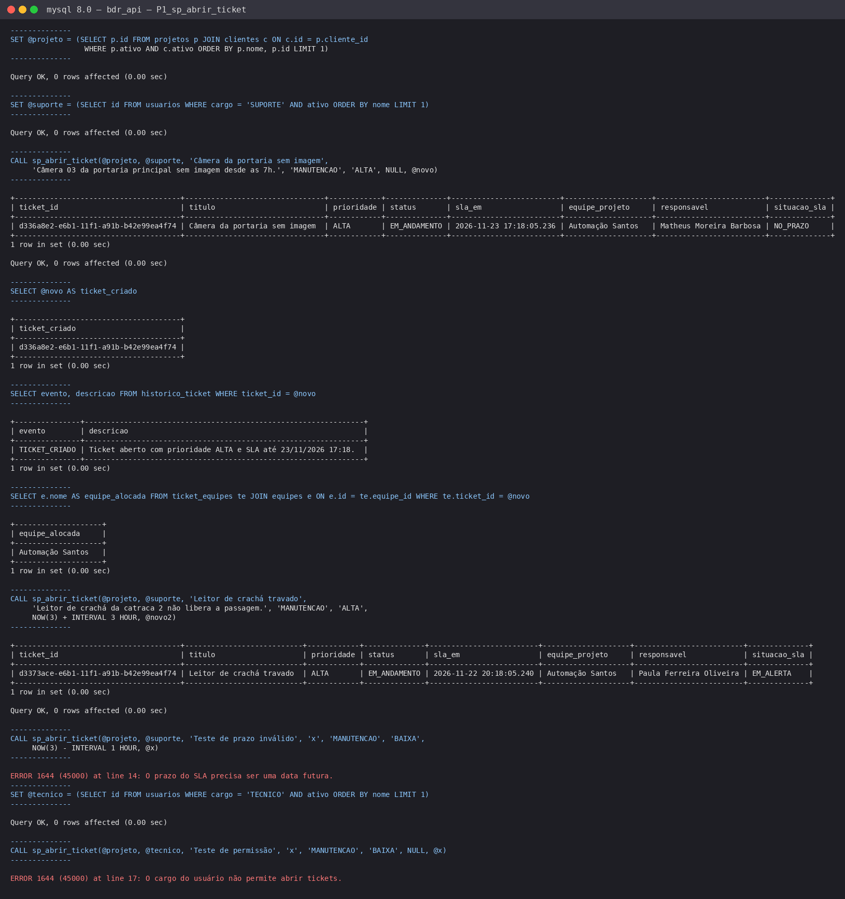

<details><summary>Saída em texto</summary>

```text
--------------
SET @projeto = (SELECT p.id FROM projetos p JOIN clientes c ON c.id = p.cliente_id
                 WHERE p.ativo AND c.ativo ORDER BY p.nome, p.id LIMIT 1)
--------------

Query OK, 0 rows affected (0.00 sec)

--------------
SET @suporte = (SELECT id FROM usuarios WHERE cargo = 'SUPORTE' AND ativo ORDER BY nome LIMIT 1)
--------------

Query OK, 0 rows affected (0.00 sec)

--------------
CALL sp_abrir_ticket(@projeto, @suporte, 'Câmera da portaria sem imagem',
     'Câmera 03 da portaria principal sem imagem desde as 7h.', 'MANUTENCAO', 'ALTA', NULL, @novo)
--------------

+--------------------------------------+--------------------------------+------------+--------------+-------------------------+--------------------+-------------------------+--------------+
| ticket_id                            | titulo                         | prioridade | status       | sla_em                  | equipe_projeto     | responsavel             | situacao_sla |
+--------------------------------------+--------------------------------+------------+--------------+-------------------------+--------------------+-------------------------+--------------+
| d336a8e2-e6b1-11f1-a91b-b42e99ea4f74 | Câmera da portaria sem imagem  | ALTA       | EM_ANDAMENTO | 2026-11-23 17:18:05.236 | Automação Santos   | Matheus Moreira Barbosa | NO_PRAZO     |
+--------------------------------------+--------------------------------+------------+--------------+-------------------------+--------------------+-------------------------+--------------+
1 row in set (0.00 sec)

Query OK, 0 rows affected (0.00 sec)

--------------
SELECT @novo AS ticket_criado
--------------

+--------------------------------------+
| ticket_criado                        |
+--------------------------------------+
| d336a8e2-e6b1-11f1-a91b-b42e99ea4f74 |
+--------------------------------------+
1 row in set (0.00 sec)

--------------
SELECT evento, descricao FROM historico_ticket WHERE ticket_id = @novo
--------------

+---------------+----------------------------------------------------------------+
| evento        | descricao                                                      |
+---------------+----------------------------------------------------------------+
| TICKET_CRIADO | Ticket aberto com prioridade ALTA e SLA até 23/11/2026 17:18.  |
+---------------+----------------------------------------------------------------+
1 row in set (0.00 sec)

--------------
SELECT e.nome AS equipe_alocada FROM ticket_equipes te JOIN equipes e ON e.id = te.equipe_id WHERE te.ticket_id = @novo
--------------

+--------------------+
| equipe_alocada     |
+--------------------+
| Automação Santos   |
+--------------------+
1 row in set (0.00 sec)

--------------
CALL sp_abrir_ticket(@projeto, @suporte, 'Leitor de crachá travado',
     'Leitor de crachá da catraca 2 não libera a passagem.', 'MANUTENCAO', 'ALTA',
     NOW(3) + INTERVAL 3 HOUR, @novo2)
--------------

+--------------------------------------+---------------------------+------------+--------------+-------------------------+--------------------+-------------------------+--------------+
| ticket_id                            | titulo                    | prioridade | status       | sla_em                  | equipe_projeto     | responsavel             | situacao_sla |
+--------------------------------------+---------------------------+------------+--------------+-------------------------+--------------------+-------------------------+--------------+
| d3373ace-e6b1-11f1-a91b-b42e99ea4f74 | Leitor de crachá travado  | ALTA       | EM_ANDAMENTO | 2026-11-22 20:18:05.240 | Automação Santos   | Paula Ferreira Oliveira | EM_ALERTA    |
+--------------------------------------+---------------------------+------------+--------------+-------------------------+--------------------+-------------------------+--------------+
1 row in set (0.00 sec)

Query OK, 0 rows affected (0.00 sec)

--------------
CALL sp_abrir_ticket(@projeto, @suporte, 'Teste de prazo inválido', 'x', 'MANUTENCAO', 'BAIXA',
     NOW(3) - INTERVAL 1 HOUR, @x)
--------------

ERROR 1644 (45000) at line 14: O prazo do SLA precisa ser uma data futura.
--------------
SET @tecnico = (SELECT id FROM usuarios WHERE cargo = 'TECNICO' AND ativo ORDER BY nome LIMIT 1)
--------------

Query OK, 0 rows affected (0.00 sec)

--------------
CALL sp_abrir_ticket(@projeto, @tecnico, 'Teste de permissão', 'x', 'MANUTENCAO', 'BAIXA', NULL, @x)
--------------

ERROR 1644 (45000) at line 17: O cargo do usuário não permite abrir tickets.
```
</details>

### P2. sp_decidir_encerramento(ticket, gestor, aprovar, parecer) — *pensada para a API (Parte 5)*

**Problema.** O fluxo de aprovação de encerramento com parecer (solução da API). Só um GESTOR ativo de uma equipe alocada ao ticket pode decidir, e só quando o ticket está em SOLICITACAO_ENCERRAMENTO. A linha do ticket é travada (SELECT ... FOR UPDATE) para evitar decisão em
- `corrida. Aprovar` → ENCERRADO; negar -> EM_REVISAO. O parecer vai para

o histórico; o encerrado_em é preenchido pelo trigger de tickets.

**Código SQL** (`sql/05_procedures.sql`):

```sql
CREATE PROCEDURE sp_decidir_encerramento(
  IN p_ticket_id CHAR(36),
  IN p_gestor_id CHAR(36),
  IN p_aprovar   BOOLEAN,
  IN p_parecer   TEXT)
BEGIN
  DECLARE v_status   VARCHAR(30);
  DECLARE v_cargo    VARCHAR(20);
  DECLARE v_ativo    BOOLEAN;
  DECLARE v_equipe   CHAR(36);

  DECLARE EXIT HANDLER FOR SQLEXCEPTION
  BEGIN
    ROLLBACK;
    RESIGNAL;
  END;

  IF p_parecer IS NULL OR CHAR_LENGTH(TRIM(p_parecer)) < 5 THEN
    SIGNAL SQLSTATE '45000' SET MESSAGE_TEXT = 'Informe um parecer (mínimo 5 caracteres).';
  END IF;

  START TRANSACTION;
    SELECT status INTO v_status FROM tickets WHERE id = p_ticket_id FOR UPDATE;
    IF v_status IS NULL THEN
      SIGNAL SQLSTATE '45000' SET MESSAGE_TEXT = 'Ticket não encontrado.';
    END IF;
    IF v_status <> 'SOLICITACAO_ENCERRAMENTO' THEN
      SIGNAL SQLSTATE '45000' SET MESSAGE_TEXT = 'O ticket não está aguardando decisão de encerramento.';
    END IF;

    SELECT cargo, ativo, equipe_id INTO v_cargo, v_ativo, v_equipe
      FROM usuarios WHERE id = p_gestor_id;
    IF v_cargo IS NULL OR v_cargo <> 'GESTOR' OR v_ativo = FALSE THEN
      SIGNAL SQLSTATE '45000' SET MESSAGE_TEXT = 'Apenas um gestor ativo pode decidir o encerramento.';
    END IF;
    IF NOT EXISTS (SELECT 1 FROM ticket_equipes te
                    WHERE te.ticket_id = p_ticket_id AND te.equipe_id = v_equipe) THEN
      SIGNAL SQLSTATE '45000' SET MESSAGE_TEXT = 'A equipe do gestor não está alocada neste ticket.';
    END IF;

    UPDATE tickets
       SET status = IF(p_aprovar, 'ENCERRADO', 'EM_REVISAO')
     WHERE id = p_ticket_id;

    INSERT INTO historico_ticket (evento, descricao, ticket_id, usuario_id, equipe_id)
    VALUES (IF(p_aprovar, 'ENCERRAMENTO_APROVADO', 'ENCERRAMENTO_NEGADO'),
            p_parecer, p_ticket_id, p_gestor_id, v_equipe);
  COMMIT;

  SELECT t.id, t.status, t.encerrado_em, fn_situacao_sla(t.id) AS situacao_sla,
         fn_percentual_sla_consumido(t.id) AS pct_sla_consumido
    FROM tickets t WHERE t.id = p_ticket_id;
END
```

**Execução de exemplo** (bloco `-- @print P2_sp_decidir_encerramento` de `sql/07_exemplos.sql`):

```sql
USE bdr_api;
SELECT t.id, p.gestor_id INTO @tk1, @gestor1 FROM tickets t JOIN projetos p ON p.id = t.projeto_id
 WHERE t.status = 'SOLICITACAO_ENCERRAMENTO' ORDER BY t.criado_em LIMIT 1;
SELECT t.id, p.gestor_id INTO @tk2, @gestor2 FROM tickets t JOIN projetos p ON p.id = t.projeto_id
 WHERE t.status = 'SOLICITACAO_ENCERRAMENTO' ORDER BY t.criado_em LIMIT 1 OFFSET 1;
CALL sp_decidir_encerramento(@tk1, @gestor1, TRUE, 'Serviço conferido com o cliente, aprovado.');
CALL sp_decidir_encerramento(@tk2, @gestor2, FALSE, 'Falta o relatório de testes finais.');
SELECT LEFT(h.evento, 22) AS evento, LEFT(h.descricao, 60) AS descricao, u.nome AS autor
  FROM historico_ticket h LEFT JOIN usuarios u ON u.id = h.usuario_id
 WHERE h.ticket_id IN (@tk1, @tk2) AND h.criado_em >= NOW() - INTERVAL 1 MINUTE;
-- erro esperado: o ticket já foi encerrado
CALL sp_decidir_encerramento(@tk1, @gestor1, TRUE, 'Aprovando de novo.');
```

**Retorno obtido** — print: [`docs/prints/P2_sp_decidir_encerramento.png`](prints/P2_sp_decidir_encerramento.png)

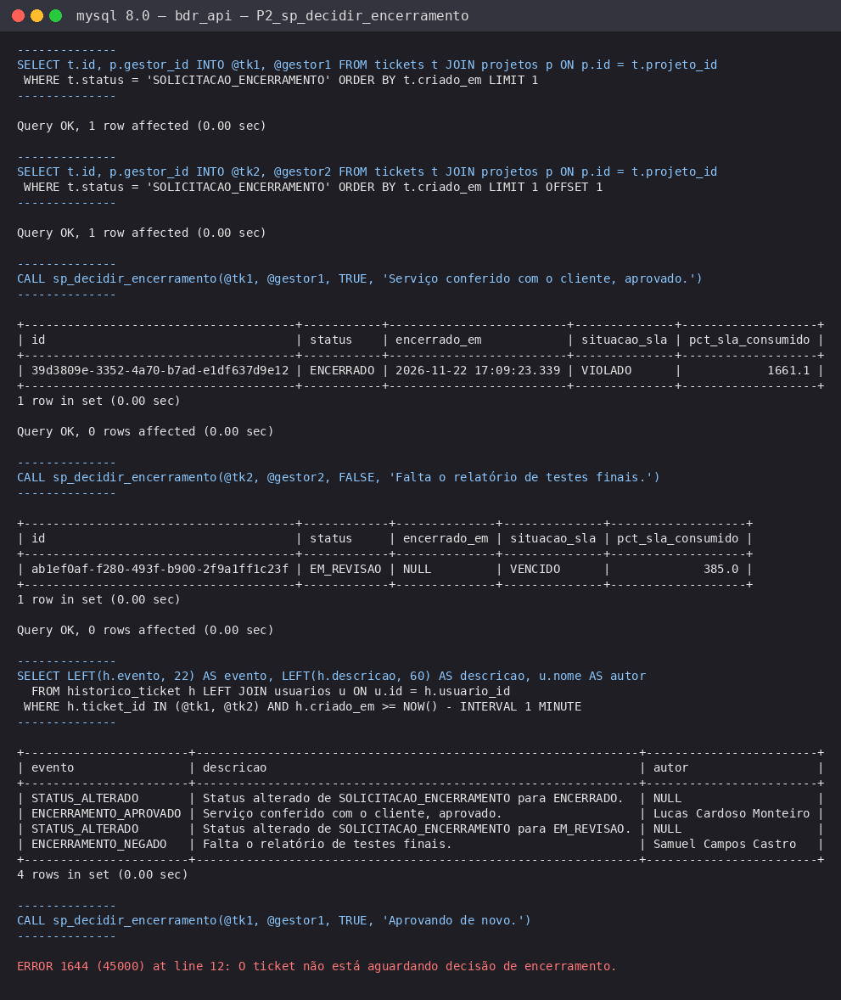

<details><summary>Saída em texto</summary>

```text
--------------
SELECT t.id, p.gestor_id INTO @tk1, @gestor1 FROM tickets t JOIN projetos p ON p.id = t.projeto_id
 WHERE t.status = 'SOLICITACAO_ENCERRAMENTO' ORDER BY t.criado_em LIMIT 1
--------------

Query OK, 1 row affected (0.00 sec)

--------------
SELECT t.id, p.gestor_id INTO @tk2, @gestor2 FROM tickets t JOIN projetos p ON p.id = t.projeto_id
 WHERE t.status = 'SOLICITACAO_ENCERRAMENTO' ORDER BY t.criado_em LIMIT 1 OFFSET 1
--------------

Query OK, 1 row affected (0.00 sec)

--------------
CALL sp_decidir_encerramento(@tk1, @gestor1, TRUE, 'Serviço conferido com o cliente, aprovado.')
--------------

+--------------------------------------+-----------+-------------------------+--------------+-------------------+
| id                                   | status    | encerrado_em            | situacao_sla | pct_sla_consumido |
+--------------------------------------+-----------+-------------------------+--------------+-------------------+
| 39d3809e-3352-4a70-b7ad-e1df637d9e12 | ENCERRADO | 2026-11-22 17:11:25.108 | VIOLADO      |            1661.3 |
+--------------------------------------+-----------+-------------------------+--------------+-------------------+
1 row in set (0.00 sec)

Query OK, 0 rows affected (0.00 sec)

--------------
CALL sp_decidir_encerramento(@tk2, @gestor2, FALSE, 'Falta o relatório de testes finais.')
--------------

+--------------------------------------+------------+--------------+--------------+-------------------+
| id                                   | status     | encerrado_em | situacao_sla | pct_sla_consumido |
+--------------------------------------+------------+--------------+--------------+-------------------+
| ab1ef0af-f280-493f-b900-2f9a1ff1c23f | EM_REVISAO | NULL         | VENCIDO      |             385.0 |
+--------------------------------------+------------+--------------+--------------+-------------------+
1 row in set (0.00 sec)

Query OK, 0 rows affected (0.00 sec)

--------------
SELECT LEFT(h.evento, 22) AS evento, LEFT(h.descricao, 60) AS descricao, u.nome AS autor
  FROM historico_ticket h LEFT JOIN usuarios u ON u.id = h.usuario_id
 WHERE h.ticket_id IN (@tk1, @tk2) AND h.criado_em >= NOW() - INTERVAL 1 MINUTE
--------------

+-----------------------+--------------------------------------------------------------+------------------------+
| evento                | descricao                                                    | autor                  |
+-----------------------+--------------------------------------------------------------+------------------------+
| STATUS_ALTERADO       | Status alterado de SOLICITACAO_ENCERRAMENTO para ENCERRADO.  | NULL                   |
| ENCERRAMENTO_APROVADO | Serviço conferido com o cliente, aprovado.                   | Lucas Cardoso Monteiro |
| STATUS_ALTERADO       | Status alterado de SOLICITACAO_ENCERRAMENTO para EM_REVISAO. | NULL                   |
| ENCERRAMENTO_NEGADO   | Falta o relatório de testes finais.                          | Samuel Campos Castro   |
+-----------------------+--------------------------------------------------------------+------------------------+
4 rows in set (0.00 sec)

--------------
CALL sp_decidir_encerramento(@tk1, @gestor1, TRUE, 'Aprovando de novo.')
--------------

ERROR 1644 (45000) at line 12: O ticket não está aguardando decisão de encerramento.
```
</details>

### P3. sp_desativar_tecnico_redistribuir(tecnico, executor)

**Problema.** Quando o Suporte Interno desativa a conta de um técnico (US 23), os tickets abertos dele ficariam sem dono. A procedure desativa a conta e percorre com um CURSOR cada ticket aberto do técnico, repassando-o para o técnico menos carregado da equipe do projeto (fn_sugerir_tecnico). Se não houver ninguém disponível o ticket fica sem responsável. Retorna o resumo da redistribuição.

**Código SQL** (`sql/05_procedures.sql`):

```sql
CREATE PROCEDURE sp_desativar_tecnico_redistribuir(
  IN p_tecnico_id  CHAR(36),
  IN p_executor_id CHAR(36))
BEGIN
  DECLARE v_fim       BOOLEAN DEFAULT FALSE;
  DECLARE v_ticket    CHAR(36);
  DECLARE v_equipe    CHAR(36);
  DECLARE v_novo      CHAR(36);
  DECLARE v_cargo     VARCHAR(20);
  DECLARE v_exec      VARCHAR(20);

  DECLARE cur_tickets CURSOR FOR
    SELECT t.id, p.equipe_id
      FROM tickets t
     INNER JOIN projetos p ON p.id = t.projeto_id
     WHERE t.responsavel_id = p_tecnico_id
       AND t.status <> 'ENCERRADO'
     ORDER BY t.sla_em;
  DECLARE CONTINUE HANDLER FOR NOT FOUND SET v_fim = TRUE;
  DECLARE EXIT HANDLER FOR SQLEXCEPTION
  BEGIN
    ROLLBACK;
    RESIGNAL;
  END;

  SELECT cargo INTO v_cargo FROM usuarios WHERE id = p_tecnico_id;
  SELECT cargo INTO v_exec  FROM usuarios WHERE id = p_executor_id AND ativo;
  SET v_fim = FALSE;  -- os SELECT INTO acima podem ter acionado o NOT FOUND
  IF v_cargo IS NULL OR v_cargo <> 'TECNICO' THEN
    SIGNAL SQLSTATE '45000' SET MESSAGE_TEXT = 'Usuário informado não é um técnico.';
  END IF;
  IF v_exec IS NULL OR v_exec <> 'SUPORTE_INTERNO' THEN
    SIGNAL SQLSTATE '45000' SET MESSAGE_TEXT = 'Somente o Suporte Interno pode desativar contas.';
  END IF;

  DROP TEMPORARY TABLE IF EXISTS tmp_redistribuicao;
  CREATE TEMPORARY TABLE tmp_redistribuicao (
    ticket_id      CHAR(36),
    novo_tecnico   CHAR(36)
  );

  START TRANSACTION;
    -- desativa primeiro: assim fn_sugerir_tecnico já não o considera
    UPDATE usuarios SET ativo = FALSE WHERE id = p_tecnico_id;

    OPEN cur_tickets;
    laco: LOOP
      FETCH cur_tickets INTO v_ticket, v_equipe;
      IF v_fim THEN
        LEAVE laco;
      END IF;

      SET v_novo = fn_sugerir_tecnico(v_equipe);
      UPDATE tickets SET responsavel_id = v_novo WHERE id = v_ticket;
      INSERT INTO tmp_redistribuicao VALUES (v_ticket, v_novo);
    END LOOP laco;
    CLOSE cur_tickets;
  COMMIT;

  SELECT r.ticket_id, t.titulo, t.prioridade,
         COALESCE(u.nome, '(sem técnico disponível)') AS novo_responsavel
    FROM tmp_redistribuicao r
   INNER JOIN tickets  t ON t.id = r.ticket_id
   LEFT  JOIN usuarios u ON u.id = r.novo_tecnico;
END
```

**Execução de exemplo** (bloco `-- @print P3_sp_desativar_tecnico_redistribuir` de `sql/07_exemplos.sql`):

```sql
USE bdr_api;
SET @tec = (SELECT responsavel_id FROM tickets WHERE status <> 'ENCERRADO' AND responsavel_id IS NOT NULL
             GROUP BY responsavel_id ORDER BY COUNT(*) DESC, responsavel_id LIMIT 1);
SET @admin = (SELECT id FROM usuarios WHERE cargo = 'SUPORTE_INTERNO' ORDER BY criado_em LIMIT 1);
SELECT nome, ativo, (SELECT COUNT(*) FROM tickets WHERE responsavel_id = @tec AND status <> 'ENCERRADO') AS abertos
  FROM usuarios WHERE id = @tec;
CALL sp_desativar_tecnico_redistribuir(@tec, @admin);
SELECT nome, ativo FROM usuarios WHERE id = @tec;
SELECT tipo, descricao FROM atividades_conta WHERE usuario_id = @tec ORDER BY criado_em DESC LIMIT 1;
```

**Retorno obtido** — print: [`docs/prints/P3_sp_desativar_tecnico_redistribuir.png`](prints/P3_sp_desativar_tecnico_redistribuir.png)

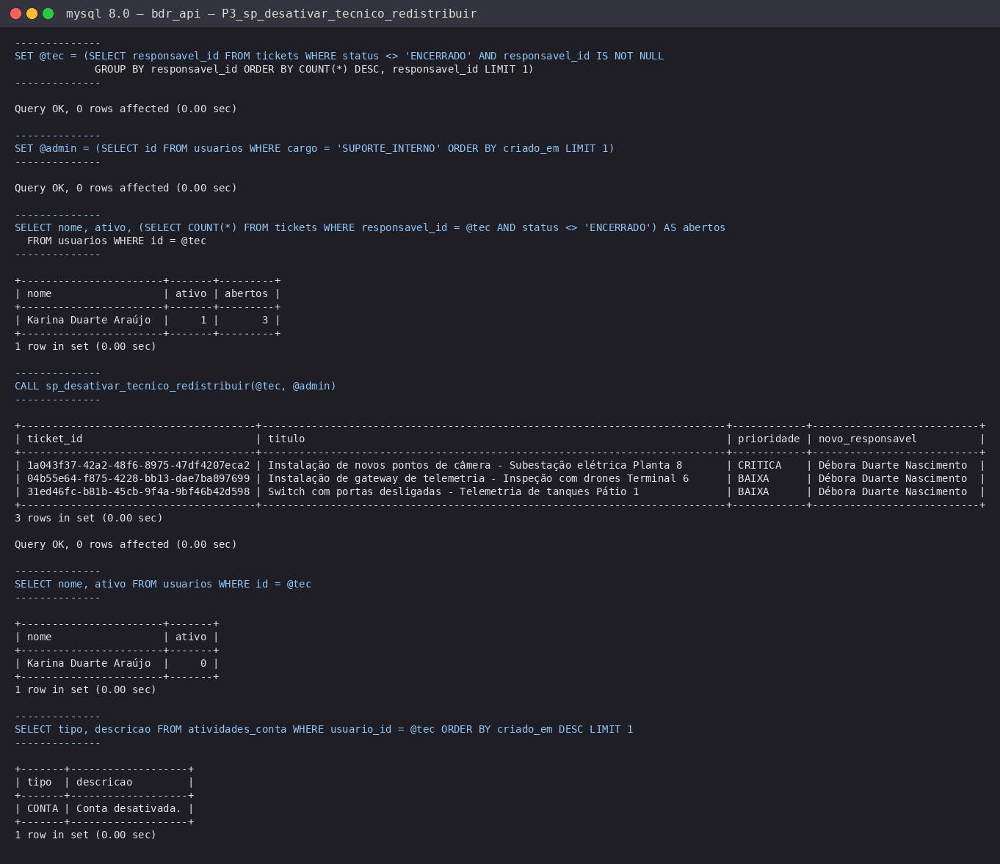

<details><summary>Saída em texto</summary>

```text
--------------
SET @tec = (SELECT responsavel_id FROM tickets WHERE status <> 'ENCERRADO' AND responsavel_id IS NOT NULL
             GROUP BY responsavel_id ORDER BY COUNT(*) DESC, responsavel_id LIMIT 1)
--------------

Query OK, 0 rows affected (0.00 sec)

--------------
SET @admin = (SELECT id FROM usuarios WHERE cargo = 'SUPORTE_INTERNO' ORDER BY criado_em LIMIT 1)
--------------

Query OK, 0 rows affected (0.00 sec)

--------------
SELECT nome, ativo, (SELECT COUNT(*) FROM tickets WHERE responsavel_id = @tec AND status <> 'ENCERRADO') AS abertos
  FROM usuarios WHERE id = @tec
--------------

+-----------------------+-------+---------+
| nome                  | ativo | abertos |
+-----------------------+-------+---------+
| Karina Duarte Araújo  |     1 |       3 |
+-----------------------+-------+---------+
1 row in set (0.00 sec)

--------------
CALL sp_desativar_tecnico_redistribuir(@tec, @admin)
--------------

+--------------------------------------+---------------------------------------------------------------------------+------------+---------------------------+
| ticket_id                            | titulo                                                                    | prioridade | novo_responsavel          |
+--------------------------------------+---------------------------------------------------------------------------+------------+---------------------------+
| 1a043f37-42a2-48f6-8975-47df4207eca2 | Instalação de novos pontos de câmera - Subestação elétrica Planta 8       | CRITICA    | Débora Duarte Nascimento  |
| 04b55e64-f875-4228-bb13-dae7ba897699 | Instalação de gateway de telemetria - Inspeção com drones Terminal 6      | BAIXA      | Débora Duarte Nascimento  |
| 31ed46fc-b81b-45cb-9f4a-9bf46b42d598 | Switch com portas desligadas - Telemetria de tanques Pátio 1              | BAIXA      | Débora Duarte Nascimento  |
+--------------------------------------+---------------------------------------------------------------------------+------------+---------------------------+
3 rows in set (0.00 sec)

Query OK, 0 rows affected (0.00 sec)

--------------
SELECT nome, ativo FROM usuarios WHERE id = @tec
--------------

+-----------------------+-------+
| nome                  | ativo |
+-----------------------+-------+
| Karina Duarte Araújo  |     0 |
+-----------------------+-------+
1 row in set (0.00 sec)

--------------
SELECT tipo, descricao FROM atividades_conta WHERE usuario_id = @tec ORDER BY criado_em DESC LIMIT 1
--------------

+-------+-------------------+
| tipo  | descricao         |
+-------+-------------------+
| CONTA | Conta desativada. |
+-------+-------------------+
1 row in set (0.00 sec)
```
</details>

### P4. sp_gerar_alertas_sla()

**Problema.** A US 19 pede um alerta ao gestor quando o SLA de um ticket estiver perto do fim. A procedure percorre com CURSOR os tickets abertos classificados como EM_ALERTA ou VENCIDO (fn_situacao_sla), registra um evento ALERTA_SLA no histórico - só se não houve alerta para o mesmo ticket nas últimas 24 h (subconsulta NOT EXISTS, evita spam) - e devolve a lista de e-mails a enviar (gestor do projeto).

**Código SQL** (`sql/05_procedures.sql`):

```sql
CREATE PROCEDURE sp_gerar_alertas_sla()
BEGIN
  DECLARE v_fim      BOOLEAN DEFAULT FALSE;
  DECLARE v_ticket   CHAR(36);
  DECLARE v_situacao VARCHAR(20);
  DECLARE v_horas    DECIMAL(10,1);
  DECLARE v_gestor   VARCHAR(120);
  DECLARE v_email    VARCHAR(254);
  DECLARE v_titulo   VARCHAR(180);

  DECLARE cur_alerta CURSOR FOR
    SELECT v.ticket_id, fn_situacao_sla(v.ticket_id), v.horas_para_sla,
           v.gestor, v.email_gestor, v.titulo
      FROM vw_tickets_detalhados v
     WHERE v.finalizado = FALSE
       AND fn_situacao_sla(v.ticket_id) IN ('EM_ALERTA', 'VENCIDO')
     ORDER BY v.sla_em;
  DECLARE CONTINUE HANDLER FOR NOT FOUND SET v_fim = TRUE;

  DROP TEMPORARY TABLE IF EXISTS tmp_alertas;
  CREATE TEMPORARY TABLE tmp_alertas (
    ticket_id   CHAR(36),
    situacao    VARCHAR(20),
    gestor      VARCHAR(120),
    email       VARCHAR(254),
    mensagem    VARCHAR(400),
    novo_alerta BOOLEAN
  );

  OPEN cur_alerta;
  laco: LOOP
    FETCH cur_alerta INTO v_ticket, v_situacao, v_horas, v_gestor, v_email, v_titulo;
    IF v_fim THEN
      LEAVE laco;
    END IF;

    IF NOT EXISTS (SELECT 1 FROM historico_ticket h
                    WHERE h.ticket_id = v_ticket
                      AND h.evento = 'ALERTA_SLA'
                      AND h.criado_em >= NOW(3) - INTERVAL 24 HOUR) THEN
      INSERT INTO historico_ticket (evento, descricao, ticket_id)
      VALUES ('ALERTA_SLA', CONCAT('Alerta automático: SLA ', v_situacao, '.'), v_ticket);

      INSERT INTO tmp_alertas VALUES
        (v_ticket, v_situacao, v_gestor, v_email,
         CONCAT('[', v_situacao, '] "', LEFT(v_titulo, 40), '" - ',
                IF(v_horas < 0, CONCAT('vencido há ', -v_horas, ' h'),
                                CONCAT('vence em ', v_horas, ' h'))),
         TRUE);
    ELSE
      INSERT INTO tmp_alertas VALUES (v_ticket, v_situacao, v_gestor, v_email,
                                      'Já alertado nas últimas 24 h', FALSE);
    END IF;
  END LOOP laco;
  CLOSE cur_alerta;

  -- e-mails a enviar agora, agrupados por gestor
  SELECT email, gestor, COUNT(*) AS qtd_tickets,
         SUM(situacao = 'VENCIDO') AS vencidos,
         LEFT(GROUP_CONCAT(mensagem ORDER BY situacao DESC SEPARATOR ' | '), 110) AS mensagens
    FROM tmp_alertas
   WHERE novo_alerta
   GROUP BY email, gestor
   ORDER BY vencidos DESC, qtd_tickets DESC;
END
```

**Execução de exemplo** (bloco `-- @print P4_sp_gerar_alertas_sla` de `sql/07_exemplos.sql`):

```sql
USE bdr_api;
CALL sp_gerar_alertas_sla();
SELECT COUNT(*) AS eventos_alerta_gravados FROM historico_ticket WHERE evento = 'ALERTA_SLA';
-- segunda execução logo em seguida: nenhum e-mail novo (anti-spam de 24 h)
CALL sp_gerar_alertas_sla();
```

**Retorno obtido** — print: [`docs/prints/P4_sp_gerar_alertas_sla.png`](prints/P4_sp_gerar_alertas_sla.png)

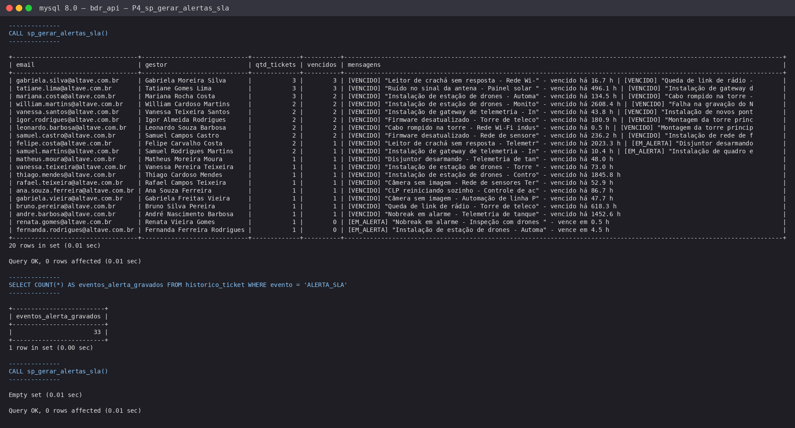

<details><summary>Saída em texto</summary>

```text
--------------
CALL sp_gerar_alertas_sla()
--------------

+----------------------------------+-----------------------------+-------------+----------+-----------------------------------------------------------------------------------------------------------------------+
| email                            | gestor                      | qtd_tickets | vencidos | mensagens                                                                                                             |
+----------------------------------+-----------------------------+-------------+----------+-----------------------------------------------------------------------------------------------------------------------+
| gabriela.silva@altave.com.br     | Gabriela Moreira Silva      |           3 |        3 | [VENCIDO] "Leitor de crachá sem resposta - Rede Wi-" - vencido há 16.8 h | [VENCIDO] "Queda de link de rádio -        |
| tatiane.lima@altave.com.br       | Tatiane Gomes Lima          |           3 |        3 | [VENCIDO] "Ruído no sinal da antena - Painel solar " - vencido há 496.2 h | [VENCIDO] "Instalação de gateway d        |
| mariana.costa@altave.com.br      | Mariana Rocha Costa         |           3 |        2 | [VENCIDO] "Instalação de estação de drones - Automa" - vencido há 134.6 h | [VENCIDO] "Cabo rompido na torre -        |
| william.martins@altave.com.br    | William Cardoso Martins     |           2 |        2 | [VENCIDO] "Instalação de estação de drones - Monito" - vencido há 2608.5 h | [VENCIDO] "Falha na gravação do N        |
| vanessa.santos@altave.com.br     | Vanessa Teixeira Santos     |           2 |        2 | [VENCIDO] "Instalação de gateway de telemetria - In" - vencido há 43.9 h | [VENCIDO] "Instalação de novos pont        |
| igor.rodrigues@altave.com.br     | Igor Almeida Rodrigues      |           2 |        2 | [VENCIDO] "Firmware desatualizado - Torre de teleco" - vencido há 181.0 h | [VENCIDO] "Montagem da torre princ        |
| leonardo.barbosa@altave.com.br   | Leonardo Souza Barbosa      |           2 |        2 | [VENCIDO] "Cabo rompido na torre - Rede Wi-Fi indus" - vencido há 0.6 h | [VENCIDO] "Montagem da torre princip        |
| samuel.castro@altave.com.br      | Samuel Campos Castro        |           2 |        2 | [VENCIDO] "Firmware desatualizado - Rede de sensore" - vencido há 236.3 h | [VENCIDO] "Instalação de rede de f        |
| felipe.costa@altave.com.br       | Felipe Carvalho Costa       |           2 |        1 | [VENCIDO] "Leitor de crachá sem resposta - Telemetr" - vencido há 2023.4 h | [EM_ALERTA] "Disjuntor desarmando        |
| samuel.martins@altave.com.br     | Samuel Rodrigues Martins    |           2 |        1 | [VENCIDO] "Instalação de gateway de telemetria - In" - vencido há 10.5 h | [EM_ALERTA] "Instalação de quadro e        |
| matheus.moura@altave.com.br      | Matheus Moreira Moura       |           1 |        1 | [VENCIDO] "Disjuntor desarmando - Telemetria de tan" - vencido há 48.1 h                                              |
| vanessa.teixeira@altave.com.br   | Vanessa Pereira Teixeira    |           1 |        1 | [VENCIDO] "Instalação de estação de drones - Torre " - vencido há 73.1 h                                              |
| thiago.mendes@altave.com.br      | Thiago Cardoso Mendes       |           1 |        1 | [VENCIDO] "Instalação de estação de drones - Contro" - vencido há 1845.9 h                                            |
| rafael.teixeira@altave.com.br    | Rafael Campos Teixeira      |           1 |        1 | [VENCIDO] "Câmera sem imagem - Rede de sensores Ter" - vencido há 53.0 h                                              |
| ana.souza.ferreira@altave.com.br | Ana Souza Ferreira          |           1 |        1 | [VENCIDO] "CLP reiniciando sozinho - Controle de ac" - vencido há 86.8 h                                              |
| gabriela.vieira@altave.com.br    | Gabriela Freitas Vieira     |           1 |        1 | [VENCIDO] "Câmera sem imagem - Automação de linha P" - vencido há 47.8 h                                              |
| bruno.pereira@altave.com.br      | Bruno Silva Pereira         |           1 |        1 | [VENCIDO] "Queda de link de rádio - Torre de teleco" - vencido há 618.4 h                                             |
| andre.barbosa@altave.com.br      | André Nascimento Barbosa    |           1 |        1 | [VENCIDO] "Nobreak em alarme - Telemetria de tanque" - vencido há 1452.7 h                                            |
| renata.gomes@altave.com.br       | Renata Vieira Gomes         |           1 |        0 | [EM_ALERTA] "Nobreak em alarme - Inspeção com drones " - vence em 0.4 h                                               |
| fernanda.rodrigues@altave.com.br | Fernanda Ferreira Rodrigues |           1 |        0 | [EM_ALERTA] "Instalação de estação de drones - Automa" - vence em 4.4 h                                               |
+----------------------------------+-----------------------------+-------------+----------+-----------------------------------------------------------------------------------------------------------------------+
20 rows in set (0.02 sec)

Query OK, 0 rows affected (0.02 sec)

--------------
SELECT COUNT(*) AS eventos_alerta_gravados FROM historico_ticket WHERE evento = 'ALERTA_SLA'
--------------

+-------------------------+
| eventos_alerta_gravados |
+-------------------------+
|                      33 |
+-------------------------+
1 row in set (0.00 sec)

--------------
CALL sp_gerar_alertas_sla()
--------------

Empty set (0.00 sec)

Query OK, 0 rows affected (0.00 sec)
```
</details>

### P5. sp_relatorio_sla_equipes(inicio, fim)

**Problema.** Falta à liderança visibilidade em tempo real do desempenho das equipes (desafio do projeto). Relatório por equipe no período: tickets recebidos, encerrados, abertos, % SLA cumprido (fn_taxa_cumprimento_sla_equipe), tempo médio de resolução (fn_tempo_medio_resolucao_equipe) e comparação com a média geral (subconsulta). LEFT JOIN + GROUP BY + HAVING (só equipes com tickets).

**Código SQL** (`sql/05_procedures.sql`):

```sql
CREATE PROCEDURE sp_relatorio_sla_equipes(IN p_inicio DATE, IN p_fim DATE)
BEGIN
  IF p_inicio IS NULL OR p_fim IS NULL OR p_inicio > p_fim THEN
    SIGNAL SQLSTATE '45000' SET MESSAGE_TEXT = 'Período inválido.';
  END IF;

  SELECT e.nome                                          AS equipe,
         COUNT(t.id)                                     AS recebidos,
         SUM(t.status = 'ENCERRADO')                     AS encerrados,
         SUM(t.status <> 'ENCERRADO')                    AS abertos,
         fn_taxa_cumprimento_sla_equipe(e.id, p_inicio, p_fim) AS pct_sla_cumprido,
         fn_tempo_medio_resolucao_equipe(e.id)           AS horas_medias_resolucao,
         CASE
           WHEN fn_taxa_cumprimento_sla_equipe(e.id, p_inicio, p_fim) >=
                (SELECT 100 * SUM(t2.encerrado_em <= t2.sla_em) / COUNT(*)
                   FROM tickets t2
                  WHERE t2.status = 'ENCERRADO'
                    AND t2.criado_em >= p_inicio
                    AND t2.criado_em < DATE_ADD(p_fim, INTERVAL 1 DAY))
           THEN 'ACIMA DA MEDIA' ELSE 'ABAIXO DA MEDIA'
         END                                             AS comparacao_geral
    FROM equipes e
    LEFT JOIN ticket_equipes te ON te.equipe_id = e.id
    LEFT JOIN tickets t
           ON t.id = te.ticket_id
          AND t.criado_em >= p_inicio
          AND t.criado_em <  DATE_ADD(p_fim, INTERVAL 1 DAY)
   GROUP BY e.id, e.nome
  HAVING COUNT(t.id) > 0
   ORDER BY pct_sla_cumprido DESC, recebidos DESC;
END
```

**Execução de exemplo** (bloco `-- @print P5_sp_relatorio_sla_equipes` de `sql/07_exemplos.sql`):

```sql
USE bdr_api;
CALL sp_relatorio_sla_equipes('2026-10-01', '2026-11-30');
```

**Retorno obtido** — print: [`docs/prints/P5_sp_relatorio_sla_equipes.png`](prints/P5_sp_relatorio_sla_equipes.png)

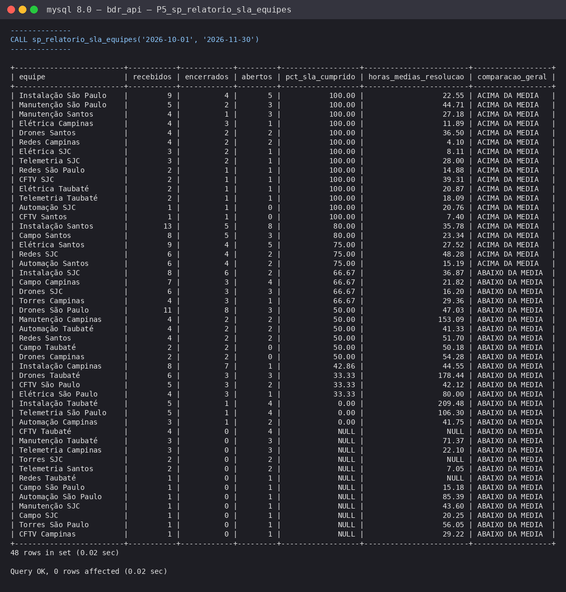

<details><summary>Saída em texto</summary>

```text
--------------
CALL sp_relatorio_sla_equipes('2026-10-01', '2026-11-30')
--------------

+-------------------------+-----------+------------+---------+------------------+------------------------+------------------+
| equipe                  | recebidos | encerrados | abertos | pct_sla_cumprido | horas_medias_resolucao | comparacao_geral |
+-------------------------+-----------+------------+---------+------------------+------------------------+------------------+
| Instalação São Paulo    |         9 |          4 |       5 |           100.00 |                  22.55 | ACIMA DA MEDIA   |
| Manutenção São Paulo    |         5 |          2 |       3 |           100.00 |                  44.71 | ACIMA DA MEDIA   |
| Manutenção Santos       |         4 |          1 |       3 |           100.00 |                  27.18 | ACIMA DA MEDIA   |
| Elétrica Campinas       |         4 |          3 |       1 |           100.00 |                  11.89 | ACIMA DA MEDIA   |
| Drones Santos           |         4 |          2 |       2 |           100.00 |                  36.50 | ACIMA DA MEDIA   |
| Redes Campinas          |         4 |          2 |       2 |           100.00 |                   4.10 | ACIMA DA MEDIA   |
| Elétrica SJC            |         3 |          2 |       1 |           100.00 |                   8.11 | ACIMA DA MEDIA   |
| Telemetria SJC          |         3 |          2 |       1 |           100.00 |                  28.00 | ACIMA DA MEDIA   |
| Redes São Paulo         |         2 |          1 |       1 |           100.00 |                  14.88 | ACIMA DA MEDIA   |
| CFTV SJC                |         2 |          1 |       1 |           100.00 |                  39.31 | ACIMA DA MEDIA   |
| Elétrica Taubaté        |         2 |          1 |       1 |           100.00 |                  20.87 | ACIMA DA MEDIA   |
| Telemetria Taubaté      |         2 |          1 |       1 |           100.00 |                  18.09 | ACIMA DA MEDIA   |
| Automação SJC           |         1 |          1 |       0 |           100.00 |                  20.76 | ACIMA DA MEDIA   |
| CFTV Santos             |         1 |          1 |       0 |           100.00 |                   7.40 | ACIMA DA MEDIA   |
| Instalação Santos       |        13 |          5 |       8 |            80.00 |                  35.78 | ACIMA DA MEDIA   |
| Campo Santos            |         8 |          5 |       3 |            80.00 |                  23.34 | ACIMA DA MEDIA   |
| Elétrica Santos         |         9 |          4 |       5 |            75.00 |                  27.52 | ACIMA DA MEDIA   |
| Redes SJC               |         6 |          4 |       2 |            75.00 |                  48.28 | ACIMA DA MEDIA   |
| Automação Santos        |         6 |          4 |       2 |            75.00 |                  15.19 | ACIMA DA MEDIA   |
| Instalação SJC          |         8 |          6 |       2 |            66.67 |                  36.87 | ABAIXO DA MEDIA  |
| Campo Campinas          |         7 |          3 |       4 |            66.67 |                  21.82 | ABAIXO DA MEDIA  |
| Drones SJC              |         6 |          3 |       3 |            66.67 |                  16.20 | ABAIXO DA MEDIA  |
| Torres Campinas         |         4 |          3 |       1 |            66.67 |                  29.36 | ABAIXO DA MEDIA  |
| Drones São Paulo        |        11 |          8 |       3 |            50.00 |                  47.03 | ABAIXO DA MEDIA  |
| Manutenção Campinas     |         4 |          2 |       2 |            50.00 |                 153.09 | ABAIXO DA MEDIA  |
| Automação Taubaté       |         4 |          2 |       2 |            50.00 |                  41.33 | ABAIXO DA MEDIA  |
| Redes Santos            |         4 |          2 |       2 |            50.00 |                  51.70 | ABAIXO DA MEDIA  |
| Campo Taubaté           |         2 |          2 |       0 |            50.00 |                  50.18 | ABAIXO DA MEDIA  |
| Drones Campinas         |         2 |          2 |       0 |            50.00 |                  54.28 | ABAIXO DA MEDIA  |
| Instalação Campinas     |         8 |          7 |       1 |            42.86 |                  44.55 | ABAIXO DA MEDIA  |
| Drones Taubaté          |         6 |          3 |       3 |            33.33 |                 178.44 | ABAIXO DA MEDIA  |
| CFTV São Paulo          |         5 |          3 |       2 |            33.33 |                  42.12 | ABAIXO DA MEDIA  |
| Elétrica São Paulo      |         4 |          3 |       1 |            33.33 |                  80.00 | ABAIXO DA MEDIA  |
| Instalação Taubaté      |         5 |          1 |       4 |             0.00 |                 209.48 | ABAIXO DA MEDIA  |
| Telemetria São Paulo    |         5 |          1 |       4 |             0.00 |                 106.30 | ABAIXO DA MEDIA  |
| Automação Campinas      |         3 |          1 |       2 |             0.00 |                  41.75 | ABAIXO DA MEDIA  |
| CFTV Taubaté            |         4 |          0 |       4 |             NULL |                   NULL | ABAIXO DA MEDIA  |
| Manutenção Taubaté      |         3 |          0 |       3 |             NULL |                  71.37 | ABAIXO DA MEDIA  |
| Telemetria Campinas     |         3 |          0 |       3 |             NULL |                  22.10 | ABAIXO DA MEDIA  |
| Torres SJC              |         2 |          0 |       2 |             NULL |                   NULL | ABAIXO DA MEDIA  |
| Telemetria Santos       |         2 |          0 |       2 |             NULL |                   7.05 | ABAIXO DA MEDIA  |
| Redes Taubaté           |         1 |          0 |       1 |             NULL |                   NULL | ABAIXO DA MEDIA  |
| Campo São Paulo         |         1 |          0 |       1 |             NULL |                  15.18 | ABAIXO DA MEDIA  |
| Automação São Paulo     |         1 |          0 |       1 |             NULL |                  85.39 | ABAIXO DA MEDIA  |
| Manutenção SJC          |         1 |          0 |       1 |             NULL |                  43.60 | ABAIXO DA MEDIA  |
| Campo SJC               |         1 |          0 |       1 |             NULL |                  20.25 | ABAIXO DA MEDIA  |
| Torres São Paulo        |         1 |          0 |       1 |             NULL |                  56.05 | ABAIXO DA MEDIA  |
| CFTV Campinas           |         1 |          0 |       1 |             NULL |                  29.22 | ABAIXO DA MEDIA  |
+-------------------------+-----------+------------+---------+------------------+------------------------+------------------+
48 rows in set (0.02 sec)

Query OK, 0 rows affected (0.02 sec)
```
</details>

### P6. sp_ranking_tecnicos(equipe, dias)

**Problema.** O gestor quer saber quais técnicos estão produzindo e quais estão sobrecarregados para distribuir as demandas (US 13). Ranking dos técnicos (de uma equipe ou de todas, se NULL) nos últimos N dias: relatórios, tickets atendidos, tickets abertos sob responsabilidade (vw_produtividade_tecnicos) e se está acima da média de relatórios da própria equipe (subconsulta derivada). RIGHT JOIN mantém técnicos sem nenhum relatório no período.

**Código SQL** (`sql/05_procedures.sql`):

```sql
CREATE PROCEDURE sp_ranking_tecnicos(IN p_equipe_id CHAR(36), IN p_dias INT)
BEGIN
  SET p_dias = COALESCE(p_dias, 30);

  SELECT RANK() OVER (ORDER BY COUNT(r.id) DESC)       AS posicao,
         u.nome                                         AS tecnico,
         e.nome                                         AS equipe,
         COUNT(r.id)                                    AS relatorios_periodo,
         COUNT(DISTINCT r.ticket_id)                    AS tickets_atendidos,
         vp.tickets_abertos_responsavel                 AS abertos_responsavel,
         ROUND(media.media_equipe, 1)                   AS media_equipe,
         IF(COUNT(r.id) >= media.media_equipe, 'SIM', 'NAO') AS acima_media
    FROM relatorios r
   RIGHT JOIN usuarios u
           ON u.id = r.autor_id
          AND r.criado_em >= NOW(3) - INTERVAL p_dias DAY
   INNER JOIN equipes e ON e.id = u.equipe_id
   INNER JOIN vw_produtividade_tecnicos vp ON vp.tecnico_id = u.id
   INNER JOIN (SELECT u2.equipe_id, COUNT(r2.id) / COUNT(DISTINCT u2.id) AS media_equipe
                 FROM usuarios u2
                 LEFT JOIN relatorios r2
                        ON r2.autor_id = u2.id
                       AND r2.criado_em >= NOW(3) - INTERVAL p_dias DAY
                WHERE u2.cargo = 'TECNICO' AND u2.ativo
                GROUP BY u2.equipe_id) media ON media.equipe_id = u.equipe_id
   WHERE u.cargo = 'TECNICO'
     AND u.ativo
     AND (p_equipe_id IS NULL OR u.equipe_id = p_equipe_id)
   GROUP BY u.id, u.nome, e.nome, vp.tickets_abertos_responsavel, media.media_equipe
   ORDER BY posicao, tecnico;
END
```

**Execução de exemplo** (bloco `-- @print P6_sp_ranking_tecnicos` de `sql/07_exemplos.sql`):

```sql
USE bdr_api;
SET @eq = (SELECT u.equipe_id FROM relatorios r JOIN usuarios u ON u.id = r.autor_id
            WHERE u.equipe_id IS NOT NULL GROUP BY u.equipe_id ORDER BY COUNT(*) DESC LIMIT 1);
CALL sp_ranking_tecnicos(@eq, 60);
-- mesma equipe, só os últimos 7 dias
CALL sp_ranking_tecnicos(@eq, 7);
```

**Retorno obtido** — print: [`docs/prints/P6_sp_ranking_tecnicos.png`](prints/P6_sp_ranking_tecnicos.png)

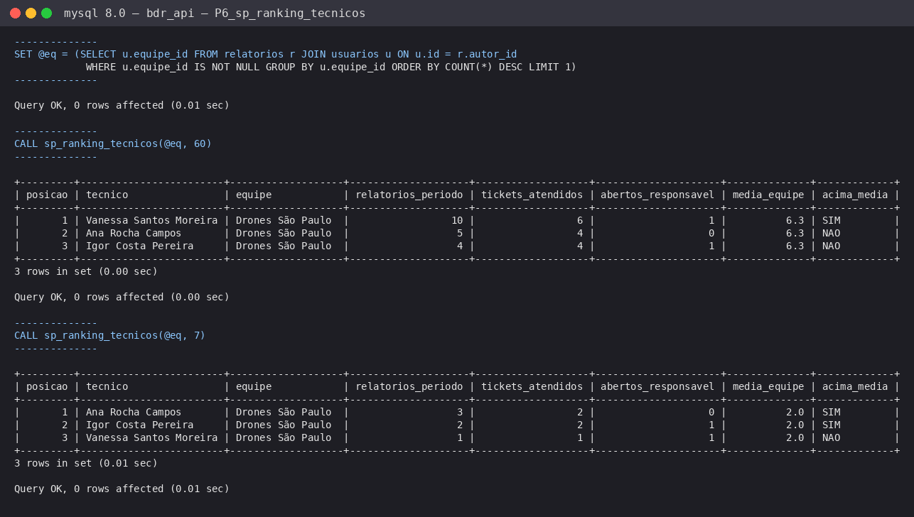

<details><summary>Saída em texto</summary>

```text
--------------
SET @eq = (SELECT u.equipe_id FROM relatorios r JOIN usuarios u ON u.id = r.autor_id
            WHERE u.equipe_id IS NOT NULL GROUP BY u.equipe_id ORDER BY COUNT(*) DESC LIMIT 1)
--------------

Query OK, 0 rows affected (0.00 sec)

--------------
CALL sp_ranking_tecnicos(@eq, 60)
--------------

+---------+------------------------+-------------------+--------------------+-------------------+---------------------+--------------+-------------+
| posicao | tecnico                | equipe            | relatorios_periodo | tickets_atendidos | abertos_responsavel | media_equipe | acima_media |
+---------+------------------------+-------------------+--------------------+-------------------+---------------------+--------------+-------------+
|       1 | Vanessa Santos Moreira | Drones São Paulo  |                 10 |                 6 |                   1 |          6.3 | SIM         |
|       2 | Ana Rocha Campos       | Drones São Paulo  |                  5 |                 4 |                   0 |          6.3 | NAO         |
|       3 | Igor Costa Pereira     | Drones São Paulo  |                  4 |                 4 |                   1 |          6.3 | NAO         |
+---------+------------------------+-------------------+--------------------+-------------------+---------------------+--------------+-------------+
3 rows in set (0.01 sec)

Query OK, 0 rows affected (0.01 sec)

--------------
CALL sp_ranking_tecnicos(@eq, 7)
--------------

+---------+------------------------+-------------------+--------------------+-------------------+---------------------+--------------+-------------+
| posicao | tecnico                | equipe            | relatorios_periodo | tickets_atendidos | abertos_responsavel | media_equipe | acima_media |
+---------+------------------------+-------------------+--------------------+-------------------+---------------------+--------------+-------------+
|       1 | Ana Rocha Campos       | Drones São Paulo  |                  3 |                 2 |                   0 |          2.0 | SIM         |
|       2 | Igor Costa Pereira     | Drones São Paulo  |                  2 |                 2 |                   1 |          2.0 | SIM         |
|       3 | Vanessa Santos Moreira | Drones São Paulo  |                  1 |                 1 |                   1 |          2.0 | NAO         |
+---------+------------------------+-------------------+--------------------+-------------------+---------------------+--------------+-------------+
3 rows in set (0.00 sec)

Query OK, 0 rows affected (0.00 sec)
```
</details>


### 3.3 Triggers

### T1. trg_tickets_bi_validar  (BEFORE INSERT ON tickets)

**Problema.** Qualquer caminho de inserção (API, carga, outro sistema) precisa respeitar as regras de abertura: projeto e cliente ativos, quem abre deve estar ativo, ticket nasce aberto (nunca ENCERRADO) e, se o SLA não for informado (NULL), é calculado pela prioridade com fn_calcular_sla_em.

**Código SQL** (`sql/06_triggers.sql`):

```sql
CREATE TRIGGER trg_tickets_bi_validar
BEFORE INSERT ON tickets
FOR EACH ROW
BEGIN
  DECLARE v_ok BOOLEAN;

  SET NEW.criado_em = COALESCE(NEW.criado_em, NOW(3));

  SELECT (p.ativo AND c.ativo) INTO v_ok
    FROM projetos p
   INNER JOIN clientes c ON c.id = p.cliente_id
   WHERE p.id = NEW.projeto_id;
  IF v_ok IS NULL OR v_ok = FALSE THEN
    SIGNAL SQLSTATE '45000'
      SET MESSAGE_TEXT = 'Não é possível abrir ticket: projeto ou cliente inativo/inexistente.';
  END IF;

  IF NOT EXISTS (SELECT 1 FROM usuarios WHERE id = NEW.aberto_por_id AND ativo) THEN
    SIGNAL SQLSTATE '45000' SET MESSAGE_TEXT = 'Usuário que abre o ticket está inativo ou não existe.';
  END IF;

  IF NEW.status = 'ENCERRADO' THEN
    SIGNAL SQLSTATE '45000' SET MESSAGE_TEXT = 'Um ticket não pode ser criado já encerrado.';
  END IF;
  SET NEW.encerrado_em = NULL;

  IF NEW.sla_em IS NULL THEN
    SET NEW.sla_em = fn_calcular_sla_em(NEW.prioridade, NEW.criado_em);
  END IF;
END
```

**Execução de exemplo** (bloco `-- @print T1_trg_tickets_bi_validar` de `sql/07_exemplos.sql`):

```sql
USE bdr_api;
SET @projeto = (SELECT p.id FROM projetos p JOIN clientes c ON c.id = p.cliente_id
                 WHERE p.ativo AND c.ativo ORDER BY p.nome DESC LIMIT 1);
SET @com = (SELECT id FROM usuarios WHERE cargo = 'COMERCIAL' AND ativo ORDER BY nome LIMIT 1);
-- sla_em = NULL: o trigger calcula pelo SLA padrão da prioridade CRITICA (8 h)
INSERT INTO tickets (id, titulo, descricao, categoria, prioridade, sla_em, projeto_id, aberto_por_id)
VALUES ('00000000-0000-4000-8000-000000000001', 'Queda total do link da torre', 'Sem comunicação com a torre 2.',
        'MANUTENCAO', 'CRITICA', NULL, @projeto, @com);
SELECT titulo, prioridade, status, criado_em, sla_em,
       TIMESTAMPDIFF(HOUR, criado_em, sla_em) AS horas_sla
  FROM tickets WHERE id = '00000000-0000-4000-8000-000000000001';
-- erro esperado: projeto inativo
SET @inativo = (SELECT id FROM projetos WHERE ativo = FALSE LIMIT 1);
INSERT INTO tickets (titulo, descricao, categoria, sla_em, projeto_id, aberto_por_id)
VALUES ('Ticket em projeto inativo', 'teste', 'MANUTENCAO', NULL, @inativo, @com);
-- erro esperado: ticket não nasce encerrado
INSERT INTO tickets (titulo, descricao, categoria, status, sla_em, projeto_id, aberto_por_id)
VALUES ('Ticket já encerrado', 'teste', 'MANUTENCAO', 'ENCERRADO', NULL, @projeto, @com);
```

**Retorno obtido** — print: [`docs/prints/T1_trg_tickets_bi_validar.png`](prints/T1_trg_tickets_bi_validar.png)

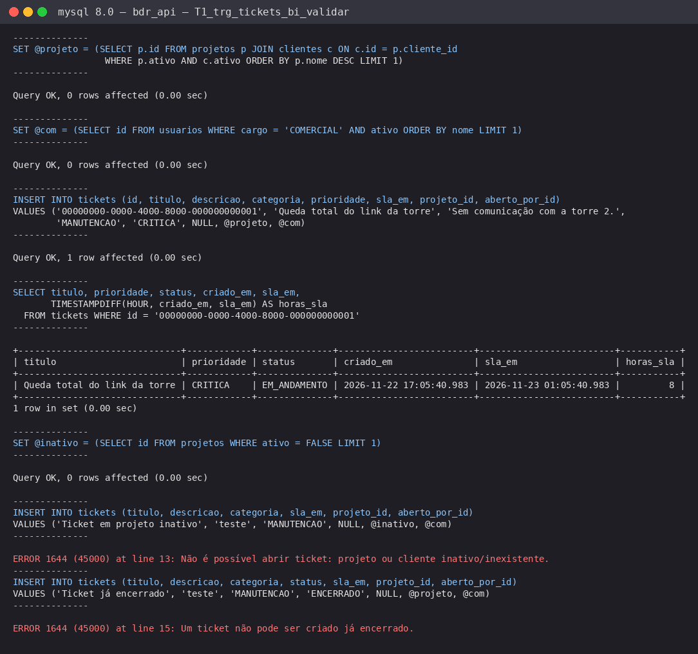

<details><summary>Saída em texto</summary>

```text
--------------
SET @projeto = (SELECT p.id FROM projetos p JOIN clientes c ON c.id = p.cliente_id
                 WHERE p.ativo AND c.ativo ORDER BY p.nome DESC LIMIT 1)
--------------

Query OK, 0 rows affected (0.00 sec)

--------------
SET @com = (SELECT id FROM usuarios WHERE cargo = 'COMERCIAL' AND ativo ORDER BY nome LIMIT 1)
--------------

Query OK, 0 rows affected (0.00 sec)

--------------
INSERT INTO tickets (id, titulo, descricao, categoria, prioridade, sla_em, projeto_id, aberto_por_id)
VALUES ('00000000-0000-4000-8000-000000000001', 'Queda total do link da torre', 'Sem comunicação com a torre 2.',
        'MANUTENCAO', 'CRITICA', NULL, @projeto, @com)
--------------

Query OK, 1 row affected (0.00 sec)

--------------
SELECT titulo, prioridade, status, criado_em, sla_em,
       TIMESTAMPDIFF(HOUR, criado_em, sla_em) AS horas_sla
  FROM tickets WHERE id = '00000000-0000-4000-8000-000000000001'
--------------

+------------------------------+------------+--------------+-------------------------+-------------------------+-----------+
| titulo                       | prioridade | status       | criado_em               | sla_em                  | horas_sla |
+------------------------------+------------+--------------+-------------------------+-------------------------+-----------+
| Queda total do link da torre | CRITICA    | EM_ANDAMENTO | 2026-11-22 17:11:25.406 | 2026-11-23 01:11:25.406 |         8 |
+------------------------------+------------+--------------+-------------------------+-------------------------+-----------+
1 row in set (0.00 sec)

--------------
SET @inativo = (SELECT id FROM projetos WHERE ativo = FALSE LIMIT 1)
--------------

Query OK, 0 rows affected (0.00 sec)

--------------
INSERT INTO tickets (titulo, descricao, categoria, sla_em, projeto_id, aberto_por_id)
VALUES ('Ticket em projeto inativo', 'teste', 'MANUTENCAO', NULL, @inativo, @com)
--------------

ERROR 1644 (45000) at line 13: Não é possível abrir ticket: projeto ou cliente inativo/inexistente.
--------------
INSERT INTO tickets (titulo, descricao, categoria, status, sla_em, projeto_id, aberto_por_id)
VALUES ('Ticket já encerrado', 'teste', 'MANUTENCAO', 'ENCERRADO', NULL, @projeto, @com)
--------------

ERROR 1644 (45000) at line 15: Um ticket não pode ser criado já encerrado.
```
</details>

### T2. trg_tickets_bu_fluxo_status  (BEFORE UPDATE ON tickets)

**Problema.** A API sofreu bugs de "alterar ticket encerrado" e de transições inválidas (ver commits do projeto). O trigger garante no banco: (a) ticket ENCERRADO não pode mais ser alterado; (b) só são aceitas as transições do fluxo:
- `NAO_INICIADO` → EM_ANDAMENTO
- `EM_ANDAMENTO / EM_REVISAO` → SOLICITACAO_ENCERRAMENTO
- `EM_REVISAO` → EM_ANDAMENTO
- `SOLICITACAO_ENCERRAMENTO` → ENCERRADO | EM_REVISAO

(c) preenche encerrado_em automaticamente ao encerrar.

**Código SQL** (`sql/06_triggers.sql`):

```sql
CREATE TRIGGER trg_tickets_bu_fluxo_status
BEFORE UPDATE ON tickets
FOR EACH ROW
BEGIN
  IF OLD.status = 'ENCERRADO' THEN
    SIGNAL SQLSTATE '45000' SET MESSAGE_TEXT = 'Ticket encerrado não pode ser alterado.';
  END IF;

  IF NEW.status <> OLD.status AND NOT (
       (OLD.status = 'NAO_INICIADO'  AND NEW.status = 'EM_ANDAMENTO') OR
       (OLD.status IN ('EM_ANDAMENTO', 'EM_REVISAO') AND NEW.status = 'SOLICITACAO_ENCERRAMENTO') OR
       (OLD.status = 'EM_REVISAO'    AND NEW.status = 'EM_ANDAMENTO') OR
       (OLD.status = 'SOLICITACAO_ENCERRAMENTO' AND NEW.status IN ('ENCERRADO', 'EM_REVISAO'))
     ) THEN
    SIGNAL SQLSTATE '45000' SET MESSAGE_TEXT = 'Transição de status não permitida.';
  END IF;

  IF NEW.status = 'ENCERRADO' THEN
    SET NEW.encerrado_em = NOW(3);
  ELSE
    SET NEW.encerrado_em = NULL;
  END IF;
END
```

**Execução de exemplo** (bloco `-- @print T2_trg_tickets_bu_fluxo_status` de `sql/07_exemplos.sql`):

```sql
USE bdr_api;
SET @enc = (SELECT id FROM tickets WHERE status = 'ENCERRADO' ORDER BY criado_em LIMIT 1);
SET @ni  = (SELECT id FROM tickets WHERE status = 'NAO_INICIADO' ORDER BY criado_em LIMIT 1);
SET @sol = (SELECT id FROM tickets WHERE status = 'SOLICITACAO_ENCERRAMENTO' ORDER BY criado_em LIMIT 1);
-- erro esperado: ticket encerrado não pode ser alterado
UPDATE tickets SET prioridade = 'CRITICA' WHERE id = @enc;
-- erro esperado: NAO_INICIADO -> ENCERRADO pula o fluxo
UPDATE tickets SET status = 'ENCERRADO' WHERE id = @ni;
-- transição válida: o trigger preenche encerrado_em
UPDATE tickets SET status = 'ENCERRADO' WHERE id = @sol;
SELECT status, encerrado_em, fn_situacao_sla(id) AS situacao_sla FROM tickets WHERE id = @sol;
```

**Retorno obtido** — print: [`docs/prints/T2_trg_tickets_bu_fluxo_status.png`](prints/T2_trg_tickets_bu_fluxo_status.png)

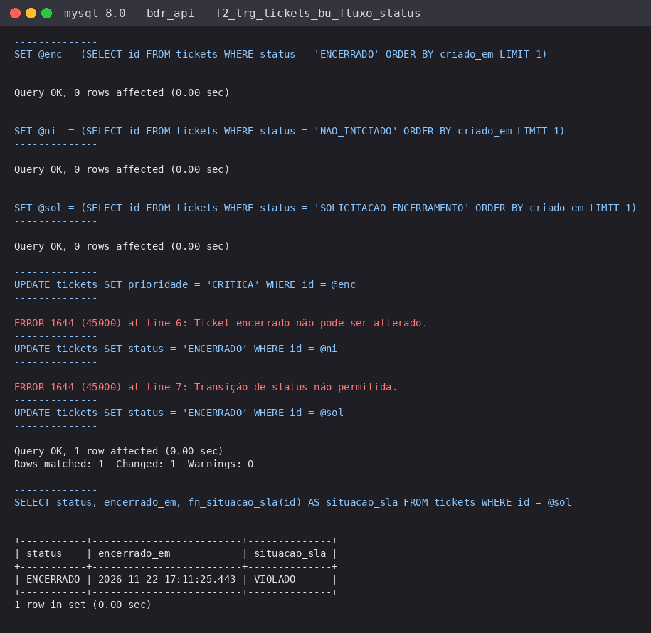

<details><summary>Saída em texto</summary>

```text
--------------
SET @enc = (SELECT id FROM tickets WHERE status = 'ENCERRADO' ORDER BY criado_em LIMIT 1)
--------------

Query OK, 0 rows affected (0.00 sec)

--------------
SET @ni  = (SELECT id FROM tickets WHERE status = 'NAO_INICIADO' ORDER BY criado_em LIMIT 1)
--------------

Query OK, 0 rows affected (0.00 sec)

--------------
SET @sol = (SELECT id FROM tickets WHERE status = 'SOLICITACAO_ENCERRAMENTO' ORDER BY criado_em LIMIT 1)
--------------

Query OK, 0 rows affected (0.00 sec)

--------------
UPDATE tickets SET prioridade = 'CRITICA' WHERE id = @enc
--------------

ERROR 1644 (45000) at line 6: Ticket encerrado não pode ser alterado.
--------------
UPDATE tickets SET status = 'ENCERRADO' WHERE id = @ni
--------------

ERROR 1644 (45000) at line 7: Transição de status não permitida.
--------------
UPDATE tickets SET status = 'ENCERRADO' WHERE id = @sol
--------------

Query OK, 1 row affected (0.00 sec)
Rows matched: 1  Changed: 1  Warnings: 0

--------------
SELECT status, encerrado_em, fn_situacao_sla(id) AS situacao_sla FROM tickets WHERE id = @sol
--------------

+-----------+-------------------------+--------------+
| status    | encerrado_em            | situacao_sla |
+-----------+-------------------------+--------------+
| ENCERRADO | 2026-11-22 17:11:25.443 | VIOLADO      |
+-----------+-------------------------+--------------+
1 row in set (0.00 sec)
```
</details>

### T3. trg_tickets_au_historico  (AFTER UPDATE ON tickets)

**Problema.** Rastreabilidade completa de cada ordem de serviço. Toda mudança de status, responsável ou prazo de SLA gera automaticamente um evento no histórico (usuario_id NULL = evento do sistema), mesmo que a alteração não tenha passado pela API.

**Código SQL** (`sql/06_triggers.sql`):

```sql
CREATE TRIGGER trg_tickets_au_historico
AFTER UPDATE ON tickets
FOR EACH ROW
BEGIN
  IF NEW.status <> OLD.status THEN
    INSERT INTO historico_ticket (evento, descricao, ticket_id)
    VALUES ('STATUS_ALTERADO',
            CONCAT('Status alterado de ', OLD.status, ' para ', NEW.status, '.'), NEW.id);
  END IF;

  IF NOT (NEW.responsavel_id <=> OLD.responsavel_id) THEN
    INSERT INTO historico_ticket (evento, descricao, ticket_id)
    VALUES ('RESPONSAVEL_ALTERADO',
            CONCAT('Responsável alterado de ',
                   COALESCE((SELECT nome FROM usuarios WHERE id = OLD.responsavel_id), '(ninguém)'),
                   ' para ',
                   COALESCE((SELECT nome FROM usuarios WHERE id = NEW.responsavel_id), '(ninguém)'), '.'),
            NEW.id);
  END IF;

  IF NEW.sla_em <> OLD.sla_em THEN
    INSERT INTO historico_ticket (evento, descricao, ticket_id)
    VALUES ('SLA_ALTERADO',
            CONCAT('Prazo do SLA alterado de ', DATE_FORMAT(OLD.sla_em, '%d/%m/%Y %H:%i'),
                   ' para ', DATE_FORMAT(NEW.sla_em, '%d/%m/%Y %H:%i'), '.'), NEW.id);
  END IF;
END
```

**Execução de exemplo** (bloco `-- @print T3_trg_tickets_au_historico` de `sql/07_exemplos.sql`):

```sql
USE bdr_api;
SET @tk = (SELECT id FROM tickets WHERE status = 'EM_ANDAMENTO' ORDER BY criado_em DESC LIMIT 1);
SET @eq = (SELECT p.equipe_id FROM tickets t JOIN projetos p ON p.id = t.projeto_id WHERE t.id = @tk);
UPDATE tickets
   SET responsavel_id = fn_sugerir_tecnico(@eq),
       sla_em = sla_em + INTERVAL 24 HOUR
 WHERE id = @tk;
UPDATE tickets SET status = 'SOLICITACAO_ENCERRAMENTO' WHERE id = @tk;
SELECT evento, descricao FROM historico_ticket
 WHERE ticket_id = @tk AND usuario_id IS NULL ORDER BY criado_em, evento;
```

**Retorno obtido** — print: [`docs/prints/T3_trg_tickets_au_historico.png`](prints/T3_trg_tickets_au_historico.png)

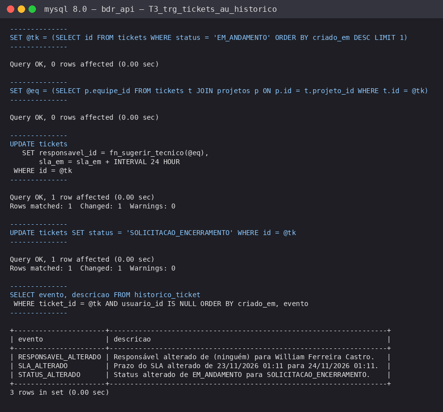

<details><summary>Saída em texto</summary>

```text
--------------
SET @tk = (SELECT id FROM tickets WHERE status = 'EM_ANDAMENTO' ORDER BY criado_em DESC LIMIT 1)
--------------

Query OK, 0 rows affected (0.00 sec)

--------------
SET @eq = (SELECT p.equipe_id FROM tickets t JOIN projetos p ON p.id = t.projeto_id WHERE t.id = @tk)
--------------

Query OK, 0 rows affected (0.00 sec)

--------------
UPDATE tickets
   SET responsavel_id = fn_sugerir_tecnico(@eq),
       sla_em = sla_em + INTERVAL 24 HOUR
 WHERE id = @tk
--------------

Query OK, 1 row affected (0.00 sec)
Rows matched: 1  Changed: 1  Warnings: 0

--------------
UPDATE tickets SET status = 'SOLICITACAO_ENCERRAMENTO' WHERE id = @tk
--------------

Query OK, 1 row affected (0.00 sec)
Rows matched: 1  Changed: 1  Warnings: 0

--------------
SELECT evento, descricao FROM historico_ticket
 WHERE ticket_id = @tk AND usuario_id IS NULL ORDER BY criado_em, evento
--------------

+----------------------+-------------------------------------------------------------------+
| evento               | descricao                                                         |
+----------------------+-------------------------------------------------------------------+
| RESPONSAVEL_ALTERADO | Responsável alterado de (ninguém) para William Ferreira Castro.   |
| SLA_ALTERADO         | Prazo do SLA alterado de 23/11/2026 01:11 para 24/11/2026 01:11.  |
| STATUS_ALTERADO      | Status alterado de EM_ANDAMENTO para SOLICITACAO_ENCERRAMENTO.    |
+----------------------+-------------------------------------------------------------------+
3 rows in set (0.00 sec)
```
</details>

### T4. trg_relatorios_bi_validar_autor  (BEFORE INSERT ON relatorios)

**Problema.** Só quem atua no ticket pode registrar relatório (US 4). O autor tem de estar ativo e pertencer a uma das equipes alocadas ao ticket (subconsulta EXISTS em ticket_equipes) e o ticket não pode estar encerrado.

**Código SQL** (`sql/06_triggers.sql`):

```sql
CREATE TRIGGER trg_relatorios_bi_validar_autor
BEFORE INSERT ON relatorios
FOR EACH ROW
BEGIN
  IF (SELECT status FROM tickets WHERE id = NEW.ticket_id) = 'ENCERRADO' THEN
    SIGNAL SQLSTATE '45000' SET MESSAGE_TEXT = 'Ticket encerrado não recebe novos relatórios.';
  END IF;

  IF NOT EXISTS (
       SELECT 1
         FROM usuarios u
        INNER JOIN ticket_equipes te ON te.equipe_id = u.equipe_id
        WHERE u.id = NEW.autor_id
          AND u.ativo
          AND te.ticket_id = NEW.ticket_id) THEN
    SIGNAL SQLSTATE '45000'
      SET MESSAGE_TEXT = 'Autor inativo ou sua equipe não está alocada neste ticket.';
  END IF;
END
```

**Execução de exemplo** (bloco `-- @print T4_trg_relatorios_bi_validar_autor` de `sql/07_exemplos.sql`):

```sql
USE bdr_api;
SET @tk = (SELECT id FROM tickets WHERE status = 'EM_ANDAMENTO' ORDER BY criado_em LIMIT 1);
-- técnico ativo de uma equipe que NÃO está alocada no ticket
SET @fora = (SELECT u.id FROM usuarios u WHERE u.cargo = 'TECNICO' AND u.ativo AND u.equipe_id IS NOT NULL
               AND u.equipe_id NOT IN (SELECT equipe_id FROM ticket_equipes WHERE ticket_id = @tk)
             ORDER BY u.nome LIMIT 1);
INSERT INTO relatorios (trabalho_realizado, materiais_utilizados, outros_detalhes, ticket_id, autor_id)
VALUES ('Tentativa de relatório por técnico de fora.', '-', '-', @tk, @fora);
-- erro esperado: ticket encerrado
SET @enc = (SELECT t.id FROM tickets t WHERE t.status = 'ENCERRADO' ORDER BY t.criado_em LIMIT 1);
SET @dentro = (SELECT u.id FROM usuarios u JOIN ticket_equipes te ON te.equipe_id = u.equipe_id
                WHERE te.ticket_id = @enc AND u.ativo AND u.cargo = 'TECNICO' LIMIT 1);
INSERT INTO relatorios (trabalho_realizado, materiais_utilizados, outros_detalhes, ticket_id, autor_id)
VALUES ('Relatório em ticket já encerrado.', '-', '-', @enc, @dentro);
SELECT COUNT(*) AS relatorios_gravados_nos_testes FROM relatorios WHERE criado_em >= NOW() - INTERVAL 1 MINUTE;
```

**Retorno obtido** — print: [`docs/prints/T4_trg_relatorios_bi_validar_autor.png`](prints/T4_trg_relatorios_bi_validar_autor.png)

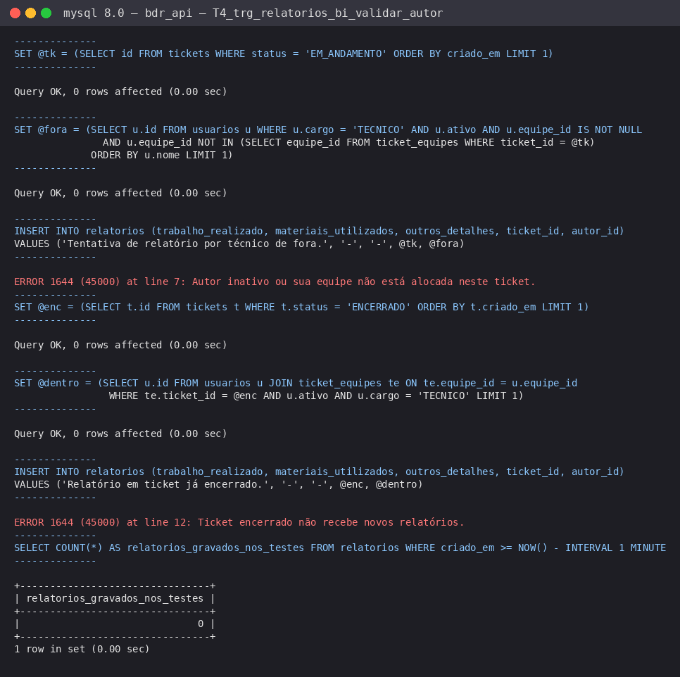

<details><summary>Saída em texto</summary>

```text
--------------
SET @tk = (SELECT id FROM tickets WHERE status = 'EM_ANDAMENTO' ORDER BY criado_em LIMIT 1)
--------------

Query OK, 0 rows affected (0.00 sec)

--------------
SET @fora = (SELECT u.id FROM usuarios u WHERE u.cargo = 'TECNICO' AND u.ativo AND u.equipe_id IS NOT NULL
               AND u.equipe_id NOT IN (SELECT equipe_id FROM ticket_equipes WHERE ticket_id = @tk)
             ORDER BY u.nome LIMIT 1)
--------------

Query OK, 0 rows affected (0.00 sec)

--------------
INSERT INTO relatorios (trabalho_realizado, materiais_utilizados, outros_detalhes, ticket_id, autor_id)
VALUES ('Tentativa de relatório por técnico de fora.', '-', '-', @tk, @fora)
--------------

ERROR 1644 (45000) at line 7: Autor inativo ou sua equipe não está alocada neste ticket.
--------------
SET @enc = (SELECT t.id FROM tickets t WHERE t.status = 'ENCERRADO' ORDER BY t.criado_em LIMIT 1)
--------------

Query OK, 0 rows affected (0.00 sec)

--------------
SET @dentro = (SELECT u.id FROM usuarios u JOIN ticket_equipes te ON te.equipe_id = u.equipe_id
                WHERE te.ticket_id = @enc AND u.ativo AND u.cargo = 'TECNICO' LIMIT 1)
--------------

Query OK, 0 rows affected (0.00 sec)

--------------
INSERT INTO relatorios (trabalho_realizado, materiais_utilizados, outros_detalhes, ticket_id, autor_id)
VALUES ('Relatório em ticket já encerrado.', '-', '-', @enc, @dentro)
--------------

ERROR 1644 (45000) at line 12: Ticket encerrado não recebe novos relatórios.
--------------
SELECT COUNT(*) AS relatorios_gravados_nos_testes FROM relatorios WHERE criado_em >= NOW() - INTERVAL 1 MINUTE
--------------

+--------------------------------+
| relatorios_gravados_nos_testes |
+--------------------------------+
|                              0 |
+--------------------------------+
1 row in set (0.00 sec)
```
</details>

### T5. trg_relatorios_ai_inicio_atividade  (AFTER INSERT ON relatorios)

**Problema.** Ao registrar o primeiro relatório de uma equipe, o técnico obviamente já iniciou o trabalho. O trigger registra o evento ATIVIDADE_INICIADA da equipe (se ainda não houver - o índice único uq_historico_inicio_equipe garante um por equipe), move o ticket de NAO_INICIADO/EM_REVISAO para EM_ANDAMENTO, grava o LOG no histórico e a atividade na conta do técnico.

**Código SQL** (`sql/06_triggers.sql`):

```sql
CREATE TRIGGER trg_relatorios_ai_inicio_atividade
AFTER INSERT ON relatorios
FOR EACH ROW
BEGIN
  DECLARE v_equipe CHAR(36);
  DECLARE v_status VARCHAR(30);

  SELECT equipe_id INTO v_equipe FROM usuarios WHERE id = NEW.autor_id;
  SELECT status    INTO v_status FROM tickets  WHERE id = NEW.ticket_id;

  IF NOT EXISTS (SELECT 1 FROM historico_ticket
                  WHERE ticket_id = NEW.ticket_id AND inicio_equipe_id = v_equipe) THEN
    INSERT INTO historico_ticket (evento, descricao, ticket_id, usuario_id, equipe_id, inicio_equipe_id)
    VALUES ('ATIVIDADE_INICIADA', 'Início registrado automaticamente pelo primeiro relatório da equipe.',
            NEW.ticket_id, NEW.autor_id, v_equipe, v_equipe);
  END IF;

  IF v_status IN ('NAO_INICIADO', 'EM_REVISAO') THEN
    UPDATE tickets SET status = 'EM_ANDAMENTO' WHERE id = NEW.ticket_id;
  END IF;

  INSERT INTO historico_ticket (evento, descricao, ticket_id, usuario_id, equipe_id)
  VALUES ('LOG', CONCAT('Relatório registrado: ', LEFT(NEW.trabalho_realizado, 120)),
          NEW.ticket_id, NEW.autor_id, v_equipe);

  INSERT INTO atividades_conta (tipo, descricao, usuario_id)
  VALUES ('LOG', CONCAT('Registrou relatório no ticket ',
                        (SELECT titulo FROM tickets WHERE id = NEW.ticket_id), '.'),
          NEW.autor_id);
END
```

**Execução de exemplo** (bloco `-- @print T5_trg_relatorios_ai_inicio_atividade` de `sql/07_exemplos.sql`):

```sql
USE bdr_api;
SELECT t.id, u.id INTO @tk, @tec
  FROM tickets t
  JOIN ticket_equipes te ON te.ticket_id = t.id
  JOIN usuarios u ON u.equipe_id = te.equipe_id AND u.cargo = 'TECNICO' AND u.ativo
 WHERE t.status = 'NAO_INICIADO' ORDER BY t.criado_em, u.nome LIMIT 1;
SELECT status FROM tickets WHERE id = @tk;
INSERT INTO relatorios (trabalho_realizado, materiais_utilizados, outros_detalhes, ticket_id, autor_id)
VALUES ('Diagnóstico inicial: fonte do equipamento queimada, substituída.', '1 fonte 12V 5A',
        'Retorno amanhã para teste final.', @tk, @tec);
SELECT status FROM tickets WHERE id = @tk;
SELECT evento, LEFT(descricao, 70) AS descricao FROM historico_ticket
 WHERE ticket_id = @tk AND criado_em >= NOW() - INTERVAL 1 MINUTE AND evento <> 'ALERTA_SLA'
 ORDER BY criado_em, evento;
SELECT tipo, descricao FROM atividades_conta WHERE usuario_id = @tec ORDER BY criado_em DESC LIMIT 1;
```

**Retorno obtido** — print: [`docs/prints/T5_trg_relatorios_ai_inicio_atividade.png`](prints/T5_trg_relatorios_ai_inicio_atividade.png)

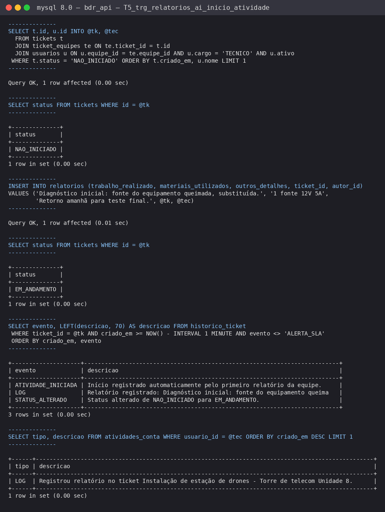

<details><summary>Saída em texto</summary>

```text
--------------
SELECT t.id, u.id INTO @tk, @tec
  FROM tickets t
  JOIN ticket_equipes te ON te.ticket_id = t.id
  JOIN usuarios u ON u.equipe_id = te.equipe_id AND u.cargo = 'TECNICO' AND u.ativo
 WHERE t.status = 'NAO_INICIADO' ORDER BY t.criado_em, u.nome LIMIT 1
--------------

Query OK, 1 row affected (0.00 sec)

--------------
SELECT status FROM tickets WHERE id = @tk
--------------

+--------------+
| status       |
+--------------+
| NAO_INICIADO |
+--------------+
1 row in set (0.00 sec)

--------------
INSERT INTO relatorios (trabalho_realizado, materiais_utilizados, outros_detalhes, ticket_id, autor_id)
VALUES ('Diagnóstico inicial: fonte do equipamento queimada, substituída.', '1 fonte 12V 5A',
        'Retorno amanhã para teste final.', @tk, @tec)
--------------

Query OK, 1 row affected (0.00 sec)

--------------
SELECT status FROM tickets WHERE id = @tk
--------------

+--------------+
| status       |
+--------------+
| EM_ANDAMENTO |
+--------------+
1 row in set (0.00 sec)

--------------
SELECT evento, LEFT(descricao, 70) AS descricao FROM historico_ticket
 WHERE ticket_id = @tk AND criado_em >= NOW() - INTERVAL 1 MINUTE AND evento <> 'ALERTA_SLA'
 ORDER BY criado_em, evento
--------------

+--------------------+--------------------------------------------------------------------------+
| evento             | descricao                                                                |
+--------------------+--------------------------------------------------------------------------+
| ATIVIDADE_INICIADA | Início registrado automaticamente pelo primeiro relatório da equipe.     |
| LOG                | Relatório registrado: Diagnóstico inicial: fonte do equipamento queima   |
| STATUS_ALTERADO    | Status alterado de NAO_INICIADO para EM_ANDAMENTO.                       |
+--------------------+--------------------------------------------------------------------------+
3 rows in set (0.00 sec)

--------------
SELECT tipo, descricao FROM atividades_conta WHERE usuario_id = @tec ORDER BY criado_em DESC LIMIT 1
--------------

+------+--------------------------------------------------------------------------------------------------+
| tipo | descricao                                                                                        |
+------+--------------------------------------------------------------------------------------------------+
| LOG  | Registrou relatório no ticket Instalação de estação de drones - Torre de telecom Unidade 8.      |
+------+--------------------------------------------------------------------------------------------------+
1 row in set (0.00 sec)
```
</details>

### T6. trg_usuarios_au_auditoria  (AFTER UPDATE ON usuarios)

**Problema.** O Suporte Interno ativa/desativa, edita e redefine senhas de contas (US 20, 23, 24) e isso precisa ficar auditado. Registra em atividades_conta cada ativação/desativação, troca de cargo, troca de equipe e redefinição de senha da conta alterada.

**Código SQL** (`sql/06_triggers.sql`):

```sql
CREATE TRIGGER trg_usuarios_au_auditoria
AFTER UPDATE ON usuarios
FOR EACH ROW
BEGIN
  IF NEW.ativo <> OLD.ativo THEN
    INSERT INTO atividades_conta (tipo, descricao, usuario_id)
    VALUES ('CONTA', IF(NEW.ativo, 'Conta reativada.', 'Conta desativada.'), NEW.id);
  END IF;

  IF NEW.cargo <> OLD.cargo THEN
    INSERT INTO atividades_conta (tipo, descricao, usuario_id)
    VALUES ('CONTA', CONCAT('Cargo alterado de ',
                            (SELECT nome FROM cargos WHERE codigo = OLD.cargo), ' para ',
                            (SELECT nome FROM cargos WHERE codigo = NEW.cargo), '.'), NEW.id);
  END IF;

  IF NOT (NEW.equipe_id <=> OLD.equipe_id) THEN
    INSERT INTO atividades_conta (tipo, descricao, usuario_id)
    VALUES ('EQUIPE', CONCAT('Equipe alterada de ',
                             COALESCE((SELECT nome FROM equipes WHERE id = OLD.equipe_id), '(nenhuma)'),
                             ' para ',
                             COALESCE((SELECT nome FROM equipes WHERE id = NEW.equipe_id), '(nenhuma)'), '.'),
            NEW.id);
  END IF;

  IF NEW.senha_hash <> OLD.senha_hash THEN
    INSERT INTO atividades_conta (tipo, descricao, usuario_id)
    VALUES ('CONTA', IF(NEW.senha_provisoria, 'Senha redefinida (provisória).', 'Senha alterada pelo usuário.'),
            NEW.id);
  END IF;
END
```

**Execução de exemplo** (bloco `-- @print T6_trg_usuarios_au_auditoria` de `sql/07_exemplos.sql`):

```sql
USE bdr_api;
SET @u = (SELECT id FROM usuarios WHERE cargo = 'TECNICO' AND equipe_id IS NULL ORDER BY nome LIMIT 1);
SET @eq = (SELECT id FROM equipes WHERE ativo ORDER BY nome LIMIT 1);
UPDATE usuarios SET equipe_id = @eq WHERE id = @u;
UPDATE usuarios SET senha_hash = '$2b$10$novaSenhaProvisoriaHashFicticio000000000000000000000', senha_provisoria = TRUE WHERE id = @u;
UPDATE usuarios SET ativo = FALSE WHERE id = @u;
UPDATE usuarios SET ativo = TRUE, cargo = 'GESTOR' WHERE id = @u;
SELECT tipo, descricao FROM atividades_conta WHERE usuario_id = @u ORDER BY criado_em, descricao;
```

**Retorno obtido** — print: [`docs/prints/T6_trg_usuarios_au_auditoria.png`](prints/T6_trg_usuarios_au_auditoria.png)

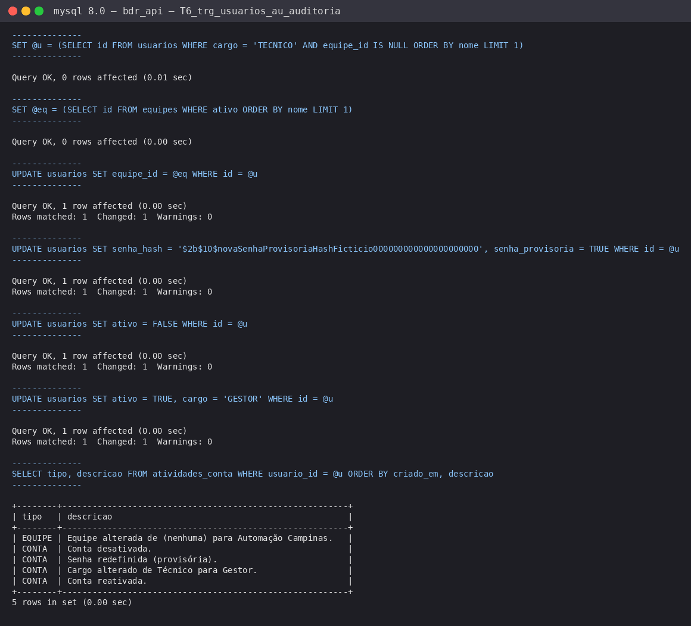

<details><summary>Saída em texto</summary>

```text
--------------
SET @u = (SELECT id FROM usuarios WHERE cargo = 'TECNICO' AND equipe_id IS NULL ORDER BY nome LIMIT 1)
--------------

Query OK, 0 rows affected (0.00 sec)

--------------
SET @eq = (SELECT id FROM equipes WHERE ativo ORDER BY nome LIMIT 1)
--------------

Query OK, 0 rows affected (0.00 sec)

--------------
UPDATE usuarios SET equipe_id = @eq WHERE id = @u
--------------

Query OK, 1 row affected (0.00 sec)
Rows matched: 1  Changed: 1  Warnings: 0

--------------
UPDATE usuarios SET senha_hash = '$2b$10$novaSenhaProvisoriaHashFicticio000000000000000000000', senha_provisoria = TRUE WHERE id = @u
--------------

Query OK, 1 row affected (0.00 sec)
Rows matched: 1  Changed: 1  Warnings: 0

--------------
UPDATE usuarios SET ativo = FALSE WHERE id = @u
--------------

Query OK, 1 row affected (0.00 sec)
Rows matched: 1  Changed: 1  Warnings: 0

--------------
UPDATE usuarios SET ativo = TRUE, cargo = 'GESTOR' WHERE id = @u
--------------

Query OK, 1 row affected (0.00 sec)
Rows matched: 1  Changed: 1  Warnings: 0

--------------
SELECT tipo, descricao FROM atividades_conta WHERE usuario_id = @u ORDER BY criado_em, descricao
--------------

+--------+---------------------------------------------------------+
| tipo   | descricao                                               |
+--------+---------------------------------------------------------+
| EQUIPE | Equipe alterada de (nenhuma) para Automação Campinas.   |
| CONTA  | Cargo alterado de Técnico para Gestor.                  |
| CONTA  | Conta desativada.                                       |
| CONTA  | Conta reativada.                                        |
| CONTA  | Senha redefinida (provisória).                          |
+--------+---------------------------------------------------------+
5 rows in set (0.00 sec)
```
</details>


---

## Parte 4 — Dicionário de dados

Arquivo separado: [`docs/dicionario-de-dados.md`](dicionario-de-dados.md). Para cada tabela, lista os campos
com descrição, tipo, nulidade, default, PK/FK/UNIQUE e as regras CHECK, além dos objetos programados
(views, functions, procedures e triggers). Foi gerado direto do `information_schema` do banco
([`scripts/gerar_dicionario.py`](../scripts/gerar_dicionario.py)), então reflete exatamente o DDL.

---

## Parte 5 — Conexão do projeto API ao banco

### 5.1 Funcionalidade escolhida: abertura de ticket com indicador de SLA

Esta funcionalidade cobre as US 1/8 (abrir ticket vinculado a um projeto) e a US 5 (indicador visual do SLA).
A API passa a:

1. **abrir o ticket pela procedure `sp_abrir_ticket`** (`CALL`), em vez de fazer o `INSERT` pelo Prisma;
2. **devolver a situação do SLA** de cada ticket na consulta e na listagem. O campo `situacaoSla` vem da function
   `fn_situacao_sla(ticket_id)`, e a tela `/tickets` mostra esse campo como um selo colorido no card.

| Rotina | Tipo | Papel na funcionalidade |
|---|---|---|
| `sp_abrir_ticket(projeto, usuário, título, descrição, categoria, prioridade, sla_em, OUT id)` | procedure (P1) | Valida o usuário (ativo, com cargo que pode abrir ticket), o projeto e o cliente (ativos) e o prazo (futuro). Numa transação, grava o ticket, a equipe do projeto (`ticket_equipes`), o histórico `TICKET_CRIADO` e a atividade `TICKET \| ABERTURA`. O técnico responsável é sugerido por `fn_sugerir_tecnico`. Devolve o id no `OUT`. |
| `fn_situacao_sla(ticket_id)` | function (F2) | Classifica o ticket em `NO_PRAZO`, `EM_ALERTA`, `VENCIDO`, `CUMPRIDO` ou `VIOLADO`. |

**Ajuste feito para encaixar na API.** O formulário da API manda o prazo como data (`slaEm`), não como horas.
Por isso o parâmetro `p_sla_horas SMALLINT` virou `p_sla_em DATETIME(3)`. Com `NULL`, a procedure continua usando o
SLA padrão da prioridade (`fn_calcular_sla_em`), e um prazo no passado é recusado. O print P1 foi regenerado.

### 5.2 Trechos de código da API que chamam as rotinas

Repositório API-2026.02, branch `Pottassiuw/shrimpfish` (commits `726fbda`, `149d510` e `565f818`).

**Procedure: `src/services/bdr-rotinas.ts`, linhas 57–76** (`abrirTicketPelaProcedure`):

```ts
return await db.$transaction(async (tx) => {
  await tx.$executeRaw`
    CALL sp_abrir_ticket(${dados.projetoId}, ${dados.abertoPorId},
         ${dados.titulo}, ${dados.descricao}, ${dados.categoria},
         ${dados.prioridade ?? null}, ${dados.slaEm}, @ticket_id)`;
  const [linha] = await tx.$queryRaw<{ id: string }[]>`
    SELECT @ticket_id AS id`;
  return linha.id;
});
```

O parâmetro `OUT` fica na variável de sessão `@ticket_id`. O `CALL` e o `SELECT` precisam rodar na mesma conexão,
então o `$transaction` só fixa a conexão do pool. Quem garante a atomicidade é a própria procedure
(`START TRANSACTION … COMMIT`, com `ROLLBACK` + `RESIGNAL` no handler). Quando a procedure faz um
`SIGNAL SQLSTATE '45000'` (código MySQL 1644), a API transforma o erro em `ErroRegraDoBanco` e o controlador
responde **HTTP 422** com a mensagem do banco (`src/controllers/ticket.controller.ts`, linha 75).

**Function: `src/services/bdr-rotinas.ts`, linhas 79–90** (`buscarSituacoesSla`), com uma consulta para toda a lista:

```ts
const linhas = await db.$queryRaw<{ id: string; situacao: SituacaoSla | null }[]>`
  SELECT id, fn_situacao_sla(id) AS situacao
    FROM tickets WHERE id IN (${Prisma.join(ticketIds)})`;
```

**Onde a API usa essas rotinas:**

| Arquivo | Linha | O quê |
|---|---|---|
| `src/services/ticket.service.ts` | 236 | `criar()`: com `USAR_ROTINAS_BDR=true` desvia para `criarPelaProcedure` |
| `src/services/ticket.service.ts` | 276–290 | `criarPelaProcedure()`: `CALL`, depois as equipes extras do formulário e o ticket com `situacaoSla` |
| `src/services/ticket.service.ts` | 411 e 422 | `listarTodos()` e `buscarDetalhePorId()` acrescentam `situacaoSla` |
| `src/lib/mappers/ticket.mapper.ts` | 141 | Inclui `situacaoSla` no JSON de resposta (`TicketView`) |
| `src/components/tickets/ticket-card.tsx` | 102 e 202 | Selo "No prazo", "SLA em alerta", "SLA vencido" etc. no card |
| `src/lib/prisma.ts` | 24 | `MYSQL_SESSION_TIME_ZONE`: fuso da sessão, para alinhar `NOW()` com o UTC do Prisma |

Sem a variável `USAR_ROTINAS_BDR`, a API funciona como antes, com o banco de dev, que não tem essas rotinas.
A mudança também tem testes unitários: `src/__tests__/services/bdr-rotinas.test.ts`.

### 5.3 Como rodar a demonstração

1. **Banco.** Suba o MySQL 8 (aqui foi usado o MySQL 8.0.40 na porta 3399) e crie o banco do zero:
   `MYSQL="mysql -uroot -h127.0.0.1 -P3399" ./scripts/rodar_tudo.sh`
2. **API.** No repositório API-2026.02, em `src/`, rode `npm ci` e depois `npx prisma generate`. Em seguida, rode
   `npm run dev` com estas variáveis (também documentadas em `docs/dev/banco-bdr.md` da API):

   ```sh
   MYSQL_HOST=127.0.0.1 MYSQL_PORT=3399 MYSQL_USER=root MYSQL_PASSWORD= MYSQL_DATABASE=bdr_api
   DATABASE_URL="mysql://root@127.0.0.1:3399/bdr_api" SESSION_SECRET="<32+ caracteres>"
   USAR_ROTINAS_BDR=true MYSQL_SESSION_TIME_ZONE=+00:00
   ```

   Não rode `prisma migrate` contra o `bdr_api`, porque o schema dele vem destes scripts.
3. **Demonstração.** Rode `API=http://127.0.0.1:3000 MYSQL="mysql -uroot -h127.0.0.1 -P3399" ./scripts/demo_parte5.sh`.
   O script faz o seguinte:
   - entra como um usuário SUPORTE;
   - cria um ticket por HTTP (`POST /api/tickets`);
   - consulta o ticket e a listagem (`GET /api/tickets/:id` e `GET /api/tickets`);
   - tenta abrir um ticket com um TÉCNICO, o que a procedure recusa;
   - roda os `SELECT`s de conferência no banco.

   Depois rode `python3 scripts/gerar_prints_parte5.py` para gerar as imagens.

**Fuso horário.** O Prisma grava `DATETIME` em UTC, e o servidor usado roda em `-03:00`. A API usa
`MYSQL_SESSION_TIME_ZONE=+00:00`, para que o `NOW()` de `sp_abrir_ticket` e de `fn_situacao_sla` fique no mesmo
referencial das datas que ela grava. O `SELECT` de conferência usa `SET time_zone = '+00:00'` pelo mesmo motivo.
Os dados do DML (Parte 3) estão no horário local, então, vistos pela API, ficam deslocados em 3 h.

### 5.4 Evidências (22/11/2026)

**1. Criação pela API, via `CALL sp_abrir_ticket`.** O ticket ALTA foi criado com prazo de 3 h. A resposta é
**HTTP 201** e traz `"situacaoSla": "EM_ALERTA"`: faltam menos que as 4 h de alerta da prioridade ALTA.
Também aparecem as duas equipes: a do projeto, gravada pela procedure, e a equipe extra do formulário.
Arquivo: [`prints/parte5/01_criar_ticket.txt`](prints/parte5/01_criar_ticket.txt).

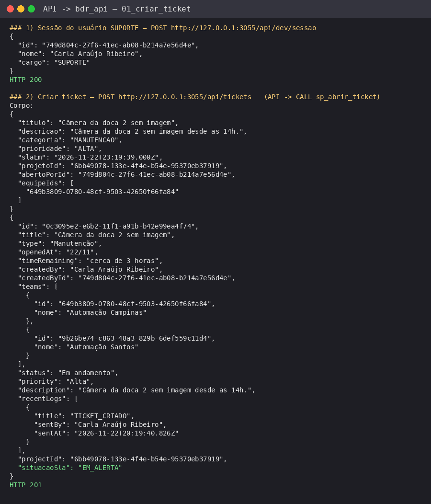

**2. Consulta e listagem.** `GET /api/tickets/:id` devolve **HTTP 200** com `situacaoSla`, e a listagem traz o
campo em todos os 221 tickets. Contagem: 33 NO_PRAZO, 10 EM_ALERTA, 30 VENCIDO, 111 CUMPRIDO e 37 VIOLADO.
Arquivo: [`prints/parte5/02_consultar_ticket.txt`](prints/parte5/02_consultar_ticket.txt).

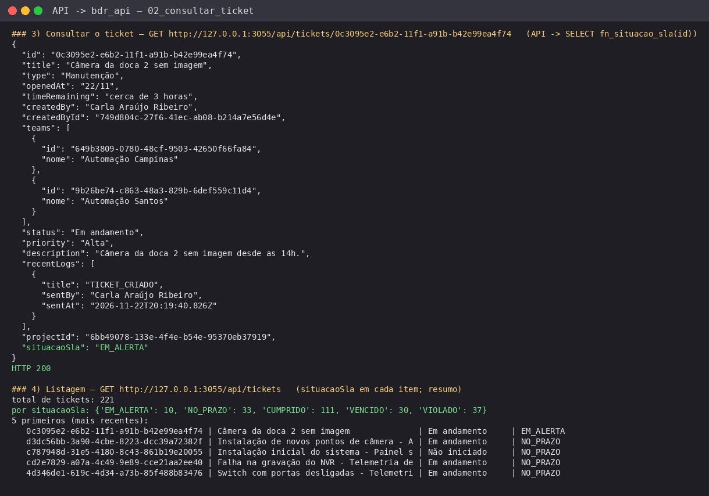

**3. Regra do banco aplicada pela API.** Um TÉCNICO da equipe do projeto tentou abrir um ticket. O controlador
da API deixaria passar, mas a procedure recusa (`cargos.pode_abrir_ticket = FALSE`) e a API responde
**HTTP 422** `{"erro":"O cargo do usuário não permite abrir tickets."}`.
Arquivo: [`prints/parte5/03_erro_regra_procedure.txt`](prints/parte5/03_erro_regra_procedure.txt).

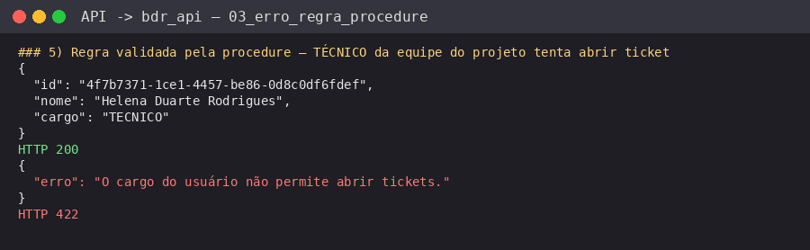

**4. Conferência no banco.** O `SELECT` mostra o ticket criado pela procedure, com `fn_situacao_sla` =
`EM_ALERTA`, o responsável sugerido (`vw_tickets_detalhados`), as duas equipes alocadas, o histórico
`TICKET_CRIADO`, a atividade `TICKET | ABERTURA` da conta e nenhum ticket do técnico recusado.
Arquivo: [`prints/parte5/04_select_banco.txt`](prints/parte5/04_select_banco.txt).

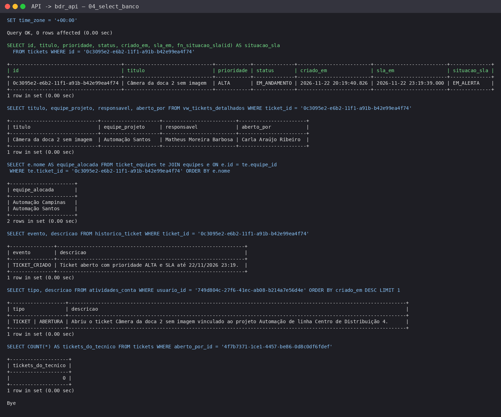

**5. Tela.** A tela `/tickets` mostra o indicador de SLA em cada card: "SLA em alerta" no ticket recém-criado e
"No prazo" no seguinte.

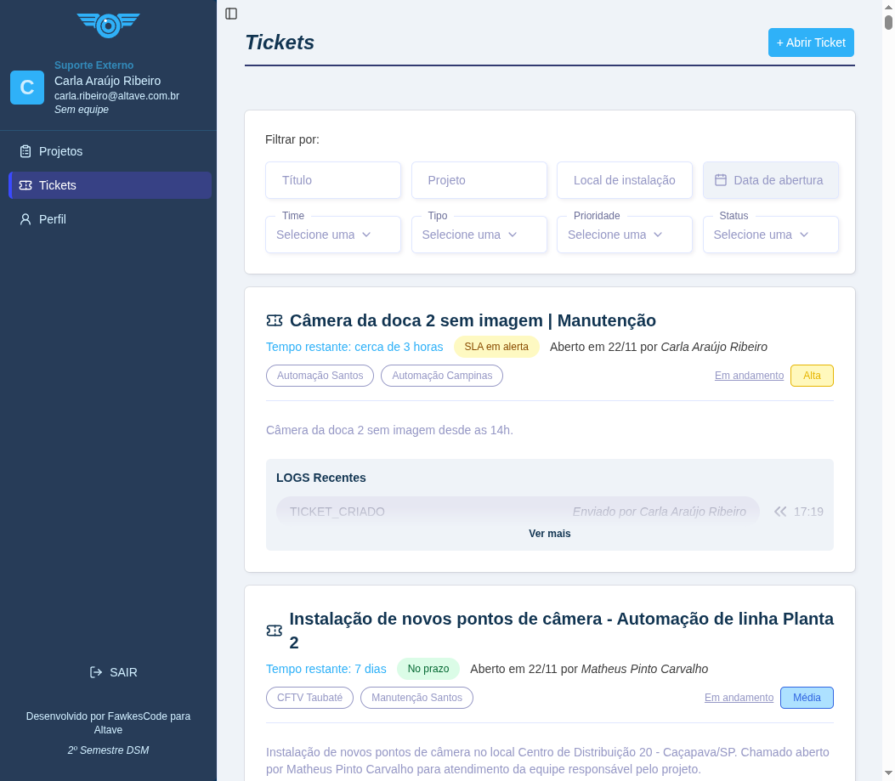
