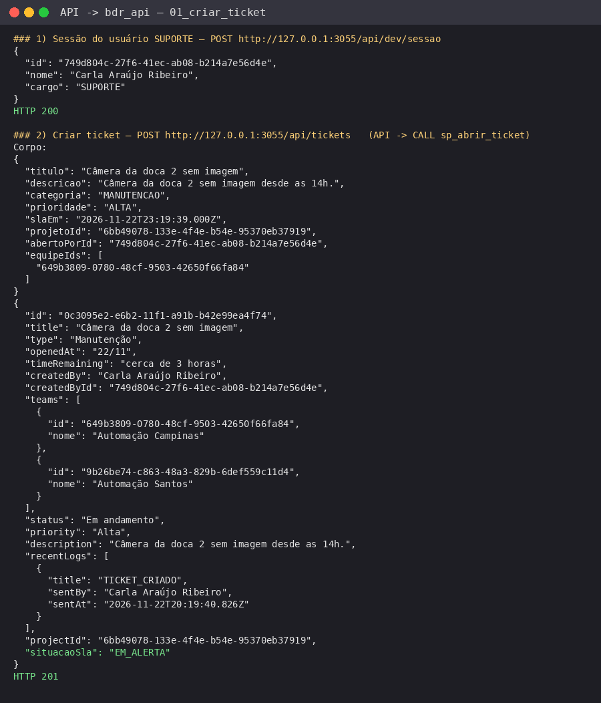
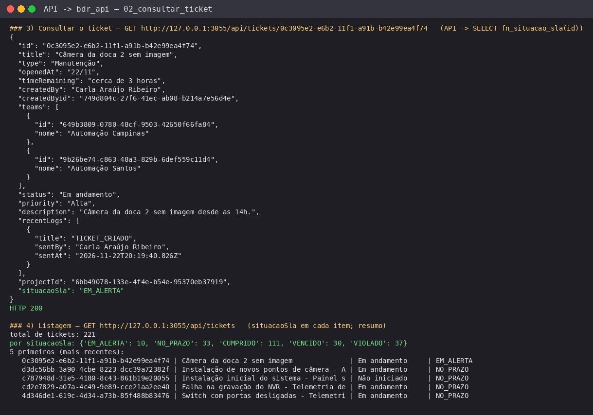
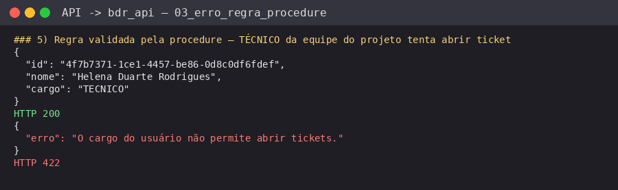
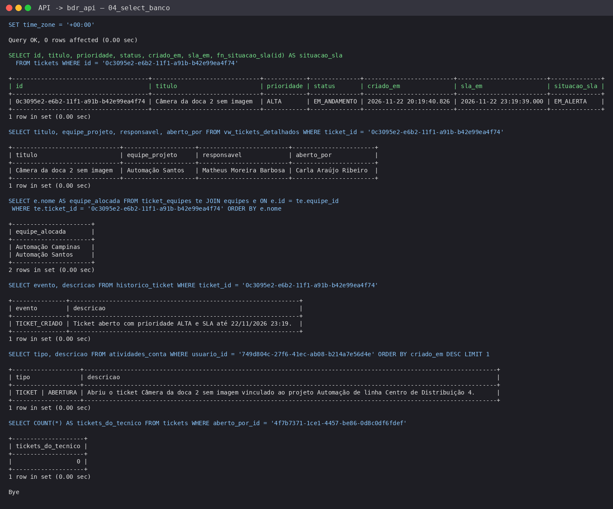
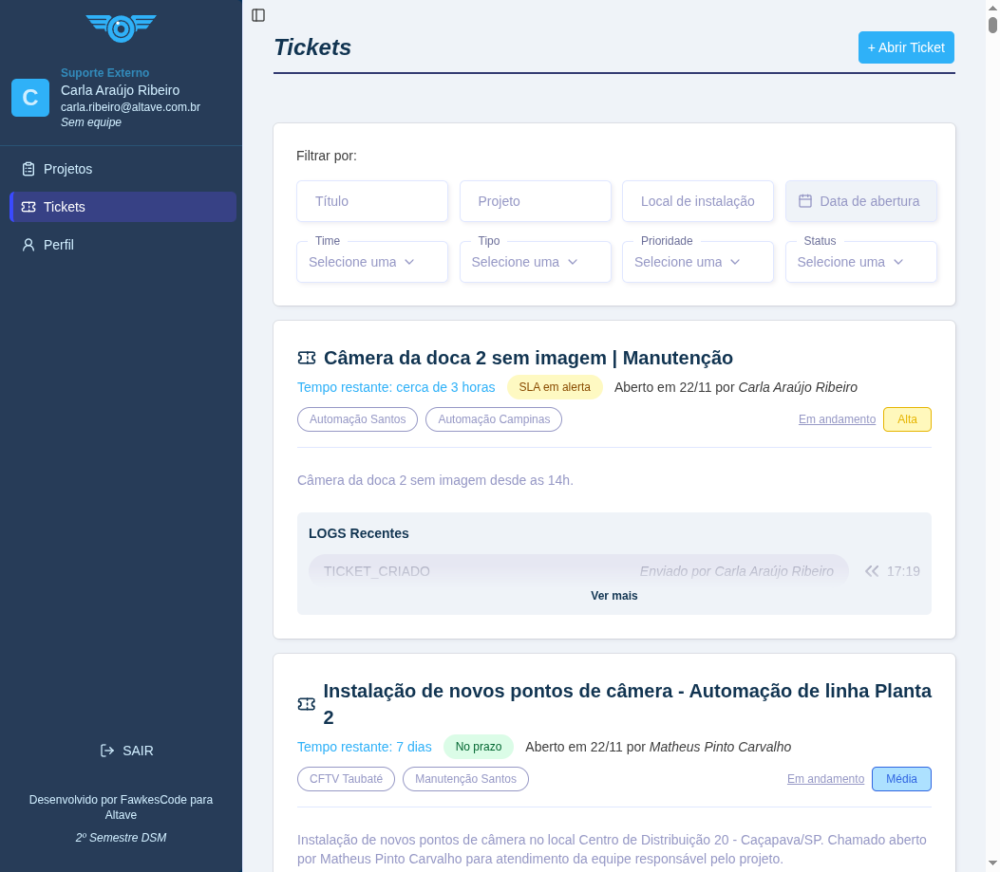

## Parte 5 — Conexão do projeto API ao banco

### 5.1 Funcionalidade escolhida: abertura de ticket com indicador de SLA

Esta funcionalidade cobre as US 1/8 (abrir ticket vinculado a um projeto) e a US 5 (indicador visual do SLA).
A API passa a:

1. **abrir o ticket pela procedure `sp_abrir_ticket`** (`CALL`), em vez de fazer o `INSERT` pelo Prisma;
2. **devolver a situação do SLA** de cada ticket na consulta e na listagem. O campo `situacaoSla` vem da function
   `fn_situacao_sla(ticket_id)`, e a tela `/tickets` mostra esse campo como um selo colorido no card.

| Rotina | Tipo | Papel na funcionalidade |
|---|---|---|
| `sp_abrir_ticket(projeto, usuário, título, descrição, categoria, prioridade, sla_em, OUT id)` | procedure (P1) | Valida o usuário (ativo, com cargo que pode abrir ticket), o projeto e o cliente (ativos) e o prazo (futuro). Numa transação, grava o ticket, a equipe do projeto (`ticket_equipes`), o histórico `TICKET_CRIADO` e a atividade `TICKET \| ABERTURA`. O técnico responsável é sugerido por `fn_sugerir_tecnico`. Devolve o id no `OUT`. |
| `fn_situacao_sla(ticket_id)` | function (F2) | Classifica o ticket em `NO_PRAZO`, `EM_ALERTA`, `VENCIDO`, `CUMPRIDO` ou `VIOLADO`. |

**Ajuste feito para encaixar na API.** O formulário da API manda o prazo como data (`slaEm`), não como horas.
Por isso o parâmetro `p_sla_horas SMALLINT` virou `p_sla_em DATETIME(3)`. Com `NULL`, a procedure continua usando o
SLA padrão da prioridade (`fn_calcular_sla_em`), e um prazo no passado é recusado. O print P1 foi regenerado.

### 5.2 Trechos de código da API que chamam as rotinas

Repositório API-2026.02, branch `Pottassiuw/shrimpfish` (commits `726fbda`, `149d510` e `565f818`).

**Procedure: `src/services/bdr-rotinas.ts`, linhas 57–76** (`abrirTicketPelaProcedure`):

```ts
return await db.$transaction(async (tx) => {
  await tx.$executeRaw`
    CALL sp_abrir_ticket(${dados.projetoId}, ${dados.abertoPorId},
         ${dados.titulo}, ${dados.descricao}, ${dados.categoria},
         ${dados.prioridade ?? null}, ${dados.slaEm}, @ticket_id)`;
  const [linha] = await tx.$queryRaw<{ id: string }[]>`
    SELECT @ticket_id AS id`;
  return linha.id;
});
```

O parâmetro `OUT` fica na variável de sessão `@ticket_id`. O `CALL` e o `SELECT` precisam rodar na mesma conexão,
então o `$transaction` só fixa a conexão do pool. Quem garante a atomicidade é a própria procedure
(`START TRANSACTION … COMMIT`, com `ROLLBACK` + `RESIGNAL` no handler). Quando a procedure faz um
`SIGNAL SQLSTATE '45000'` (código MySQL 1644), a API transforma o erro em `ErroRegraDoBanco` e o controlador
responde **HTTP 422** com a mensagem do banco (`src/controllers/ticket.controller.ts`, linha 75).

**Function: `src/services/bdr-rotinas.ts`, linhas 79–90** (`buscarSituacoesSla`), com uma consulta para toda a lista:

```ts
const linhas = await db.$queryRaw<{ id: string; situacao: SituacaoSla | null }[]>`
  SELECT id, fn_situacao_sla(id) AS situacao
    FROM tickets WHERE id IN (${Prisma.join(ticketIds)})`;
```

**Onde a API usa essas rotinas:**

| Arquivo | Linha | O quê |
|---|---|---|
| `src/services/ticket.service.ts` | 236 | `criar()`: com `USAR_ROTINAS_BDR=true` desvia para `criarPelaProcedure` |
| `src/services/ticket.service.ts` | 276–290 | `criarPelaProcedure()`: `CALL`, depois as equipes extras do formulário e o ticket com `situacaoSla` |
| `src/services/ticket.service.ts` | 411 e 422 | `listarTodos()` e `buscarDetalhePorId()` acrescentam `situacaoSla` |
| `src/lib/mappers/ticket.mapper.ts` | 141 | Inclui `situacaoSla` no JSON de resposta (`TicketView`) |
| `src/components/tickets/ticket-card.tsx` | 102 e 202 | Selo "No prazo", "SLA em alerta", "SLA vencido" etc. no card |
| `src/lib/prisma.ts` | 24 | `MYSQL_SESSION_TIME_ZONE`: fuso da sessão, para alinhar `NOW()` com o UTC do Prisma |

Sem a variável `USAR_ROTINAS_BDR`, a API funciona como antes, com o banco de dev, que não tem essas rotinas.
A mudança também tem testes unitários: `src/__tests__/services/bdr-rotinas.test.ts`.

### 5.3 Como rodar a demonstração

1. **Banco.** Suba o MySQL 8 (aqui foi usado o MySQL 8.0.40 na porta 3399) e crie o banco do zero:
   `MYSQL="mysql -uroot -h127.0.0.1 -P3399" ./scripts/rodar_tudo.sh`
2. **API.** No repositório API-2026.02, em `src/`, rode `npm ci` e depois `npx prisma generate`. Em seguida, rode
   `npm run dev` com estas variáveis (também documentadas em `docs/dev/banco-bdr.md` da API):

   ```sh
   MYSQL_HOST=127.0.0.1 MYSQL_PORT=3399 MYSQL_USER=root MYSQL_PASSWORD= MYSQL_DATABASE=bdr_api
   DATABASE_URL="mysql://root@127.0.0.1:3399/bdr_api" SESSION_SECRET="<32+ caracteres>"
   USAR_ROTINAS_BDR=true MYSQL_SESSION_TIME_ZONE=+00:00
   ```

   Não rode `prisma migrate` contra o `bdr_api`, porque o schema dele vem destes scripts.
3. **Demonstração.** Rode `API=http://127.0.0.1:3000 MYSQL="mysql -uroot -h127.0.0.1 -P3399" ./scripts/demo_parte5.sh`.
   O script faz o seguinte:
   - entra como um usuário SUPORTE;
   - cria um ticket por HTTP (`POST /api/tickets`);
   - consulta o ticket e a listagem (`GET /api/tickets/:id` e `GET /api/tickets`);
   - tenta abrir um ticket com um TÉCNICO, o que a procedure recusa;
   - roda os `SELECT`s de conferência no banco.

   Depois rode `python3 scripts/gerar_prints_parte5.py` para gerar as imagens.

**Fuso horário.** O Prisma grava `DATETIME` em UTC, e o servidor usado roda em `-03:00`. A API usa
`MYSQL_SESSION_TIME_ZONE=+00:00`, para que o `NOW()` de `sp_abrir_ticket` e de `fn_situacao_sla` fique no mesmo
referencial das datas que ela grava. O `SELECT` de conferência usa `SET time_zone = '+00:00'` pelo mesmo motivo.
Os dados do DML (Parte 3) estão no horário local, então, vistos pela API, ficam deslocados em 3 h.

### 5.4 Evidências (22/11/2026)

**1. Criação pela API, via `CALL sp_abrir_ticket`.** O ticket ALTA foi criado com prazo de 3 h. A resposta é
**HTTP 201** e traz `"situacaoSla": "EM_ALERTA"`: faltam menos que as 4 h de alerta da prioridade ALTA.
Também aparecem as duas equipes: a do projeto, gravada pela procedure, e a equipe extra do formulário.
Arquivo: [`prints/parte5/01_criar_ticket.txt`](prints/parte5/01_criar_ticket.txt).



**2. Consulta e listagem.** `GET /api/tickets/:id` devolve **HTTP 200** com `situacaoSla`, e a listagem traz o
campo em todos os 221 tickets. Contagem: 33 NO_PRAZO, 10 EM_ALERTA, 30 VENCIDO, 111 CUMPRIDO e 37 VIOLADO.
Arquivo: [`prints/parte5/02_consultar_ticket.txt`](prints/parte5/02_consultar_ticket.txt).



**3. Regra do banco aplicada pela API.** Um TÉCNICO da equipe do projeto tentou abrir um ticket. O controlador
da API deixaria passar, mas a procedure recusa (`cargos.pode_abrir_ticket = FALSE`) e a API responde
**HTTP 422** `{"erro":"O cargo do usuário não permite abrir tickets."}`.
Arquivo: [`prints/parte5/03_erro_regra_procedure.txt`](prints/parte5/03_erro_regra_procedure.txt).



**4. Conferência no banco.** O `SELECT` mostra o ticket criado pela procedure, com `fn_situacao_sla` =
`EM_ALERTA`, o responsável sugerido (`vw_tickets_detalhados`), as duas equipes alocadas, o histórico
`TICKET_CRIADO`, a atividade `TICKET | ABERTURA` da conta e nenhum ticket do técnico recusado.
Arquivo: [`prints/parte5/04_select_banco.txt`](prints/parte5/04_select_banco.txt).



**5. Tela.** A tela `/tickets` mostra o indicador de SLA em cada card: "SLA em alerta" no ticket recém-criado e
"No prazo" no seguinte.


