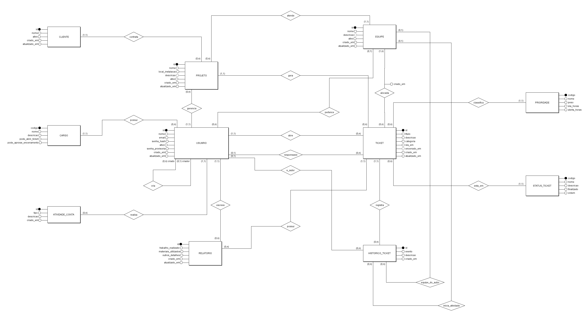
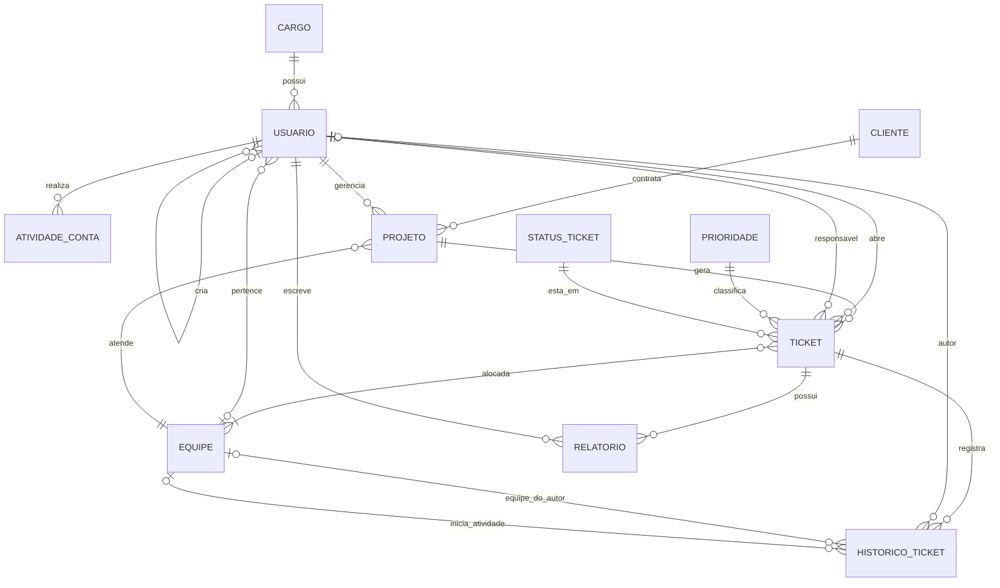

# Modelo Conceitual — bdr_api

Diagrama exportado do brModelo 3 (`modelo-conceitual.brM3`).
A fonte de verdade das entidades é o schema real da API (`API-2026.02/src/prisma/schema.prisma`).

## Entidades

| Entidade | Identificador | Atributos | Observação |
|---|---|---|---|
| CARGO | codigo | nome, descricao, pode_abrir_ticket, pode_aprovar_encerramento | Domínio (ENUM `Cargo` da API normalizado) |
| PRIORIDADE | codigo | nome, peso, sla_horas, alerta_horas | Domínio (ENUM `Prioridade`) + regra de SLA |
| STATUS_TICKET | codigo | nome, descricao, finalizado, ordem | Domínio (ENUM `StatusTicket`) |
| USUARIO | id | nome, email (único), senha_hash, ativo, senha_provisoria, criado_em, atualizado_em | |
| EQUIPE | id | nome (único), descricao, ativo, criado_em, atualizado_em | |
| CLIENTE | id | nome (único), ativo, criado_em, atualizado_em | |
| PROJETO | id | nome, local_instalacao, descricao, ativo, criado_em, atualizado_em | nome único por cliente |
| TICKET | id | titulo, descricao, categoria, sla_em, encerrado_em, criado_em, atualizado_em | |
| RELATORIO | id | trabalho_realizado, materiais_utilizados, outros_detalhes, criado_em, atualizado_em | |
| HISTORICO_TICKET | id | evento, descricao, criado_em | |
| ATIVIDADE_CONTA | id | tipo, descricao, criado_em | |

## Relacionamentos

| Relacionamento | Entidades e cardinalidades | Leitura |
|---|---|---|
| possui | USUARIO (0,n) — (1,1) CARGO | Todo usuário tem um cargo; um cargo tem vários usuários |
| pertence | USUARIO (0,n) — (0,1) EQUIPE | Usuário pode pertencer a uma equipe |
| cria (auto) | USUARIO (0,1) criador — (0,n) criado | Suporte Interno cria contas |
| realiza | USUARIO (1,1) — (0,n) ATIVIDADE_CONTA | Auditoria da conta |
| contrata | CLIENTE (1,1) — (0,n) PROJETO | |
| atende | EQUIPE (1,1) — (0,n) PROJETO | Equipe responsável pelo projeto |
| gerencia | USUARIO/gestor (1,1) — (0,n) PROJETO | |
| gera | PROJETO (1,1) — (0,n) TICKET | |
| abre | USUARIO (1,1) — (0,n) TICKET | |
| responsável | USUARIO (0,1) — (0,n) TICKET | Técnico responsável (opcional) |
| alocada | TICKET (0,n) — (1,n) EQUIPE, atributo `criado_em` | **N:N** → tabela `ticket_equipes` |
| classifica | TICKET (0,n) — (1,1) PRIORIDADE | |
| está em | TICKET (0,n) — (1,1) STATUS_TICKET | |
| possui | TICKET (1,1) — (0,n) RELATORIO | |
| escreve | USUARIO (1,1) — (0,n) RELATORIO | |
| registra | TICKET (1,1) — (0,n) HISTORICO_TICKET | |
| é autor | USUARIO (0,1) — (0,n) HISTORICO_TICKET | NULL = evento do sistema |
| equipe do autor | EQUIPE (0,1) — (0,n) HISTORICO_TICKET | Equipe do autor no momento |
| inicia atividade | EQUIPE (0,1) — (0,n) HISTORICO_TICKET | Um início por equipe por ticket |

## Mesmo modelo em Mermaid (renderiza no GitHub/VS Code)

## Arquivo do brModelo

Arquivo nativo do **brModelo 3**: `modelos/modelo-conceitual.brM3` (também em XML, `modelos/modelo-conceitual.xml`).
O XML é gerado por `scripts/brmodelo_conceitual.js`; o `.brM3` e a imagem do topo foram salvos pelo próprio brModelo 3.3
ao abrir esse XML (carga sem erros).

1. No brModelo: *Arquivo → Abrir* e escolha `modelo-conceitual.brM3` (ou o `.xml`).
2. Para a imagem do documento: *Arquivo → Exportar* (PNG) — já exportada em `modelo-conceitual.png`.
3. (Opcional) *Esquema → Converter para modelo lógico* e compare com `modelo-logico.xml`.

Convenções usadas no arquivo:
- Identificadores (`id`/`codigo`) com bolinha preenchida; atributos opcionais (NULL) tracejados.
- Cardinalidade escrita **junto à entidade** (notação do brModelo): ex. em `possui`, `(1,1)` ao lado de CARGO
  = cada usuário tem exatamente um cargo; `(0,n)` ao lado de USUARIO = um cargo tem vários usuários.
- `cria` é autorrelacionamento de USUARIO com os papéis `criador` (0,1) e `criado` (0,n).
- `alocada` é N:N (TICKET–EQUIPE) com o atributo `criado_em` no próprio relacionamento.
- As linhas são "inteligentes": o brModelo recalcula o traçado ao abrir. Se alguma ficar cruzando,
  basta arrastar a entidade/losango.

Para regerar: `node scripts/brmodelo_conceitual.js modelos`.
