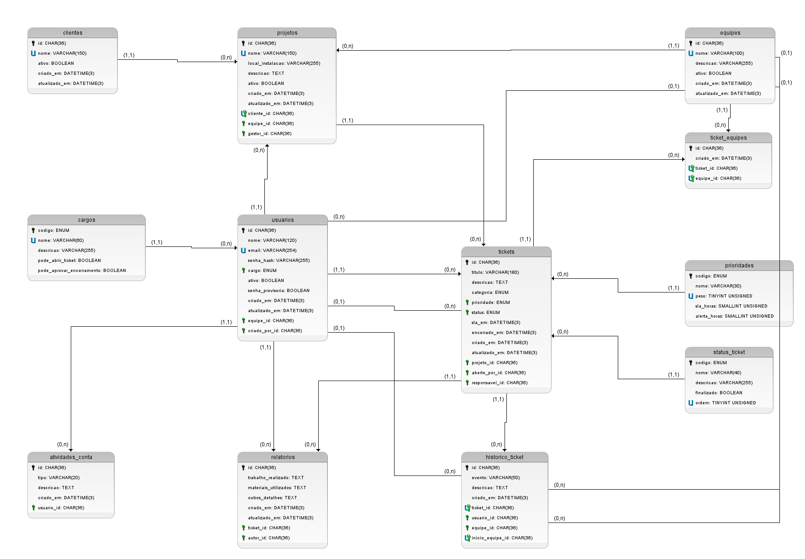

# Modelo Lógico — bdr_api (MySQL 8)

Mapeamento do modelo conceitual para tabelas relacionais. Implementado em `sql/01_ddl.sql`;
detalhes de cada campo em `docs/dicionario-de-dados.md`.

## Esquema relacional (notação textual)

Sublinhado = PK, `#` = FK.

- **cargos** (<u>codigo</u>, nome, descricao, pode_abrir_ticket, pode_aprovar_encerramento)
- **prioridades** (<u>codigo</u>, nome, peso, sla_horas, alerta_horas)
- **status_ticket** (<u>codigo</u>, nome, descricao, finalizado, ordem)
- **equipes** (<u>id</u>, nome, descricao, ativo, criado_em, atualizado_em)
- **usuarios** (<u>id</u>, nome, email, senha_hash, #cargo → cargos, ativo, senha_provisoria, criado_em, atualizado_em, #equipe_id → equipes, #criado_por_id → usuarios)
- **clientes** (<u>id</u>, nome, ativo, criado_em, atualizado_em)
- **projetos** (<u>id</u>, nome, local_instalacao, descricao, ativo, criado_em, atualizado_em, #cliente_id → clientes, #equipe_id → equipes, #gestor_id → usuarios)
- **tickets** (<u>id</u>, titulo, descricao, categoria, #prioridade → prioridades, #status → status_ticket, sla_em, encerrado_em, criado_em, atualizado_em, #projeto_id → projetos, #aberto_por_id → usuarios, #responsavel_id → usuarios)
- **ticket_equipes** (<u>id</u>, criado_em, #ticket_id → tickets, #equipe_id → equipes) — UNIQUE (ticket_id, equipe_id)
- **relatorios** (<u>id</u>, trabalho_realizado, materiais_utilizados, outros_detalhes, criado_em, atualizado_em, #ticket_id → tickets, #autor_id → usuarios)
- **historico_ticket** (<u>id</u>, evento, descricao, criado_em, #ticket_id → tickets, #usuario_id → usuarios, #equipe_id → equipes, #inicio_equipe_id → equipes) — UNIQUE (ticket_id, inicio_equipe_id)
- **atividades_conta** (<u>id</u>, tipo, descricao, criado_em, #usuario_id → usuarios)

## Decisões de mapeamento

1. **Compatibilidade com a API (Parte 5).** Nomes de tabelas/colunas, tipos (`CHAR(36)` UUID,
   `DATETIME(3)`, ENUMs) e índices são os mesmos gerados pelas migrations do Prisma. A API pode
   apontar o `DATABASE_URL` para `bdr_api` sem mudar o código.
2. **Normalização dos ENUMs.** `Cargo`, `Prioridade` e `StatusTicket` viraram as tabelas de domínio
   `cargos`, `prioridades` e `status_ticket`. As colunas continuam ENUM (o Prisma exige), mas agora
   são FK para o domínio, que guarda regras de negócio (SLA padrão e alerta por prioridade, permissões
   por cargo, status final). `categoria` (2 valores fixos) continuou só ENUM.
3. **Relacionamento N:N** TICKET—EQUIPE virou a associativa `ticket_equipes` (com `criado_em` e
   UNIQUE do par).
4. **Relacionamentos 1:N** viraram FK no lado N. Opcionais (0,1) → coluna NULL e `ON DELETE SET NULL`;
   obrigatórios → NOT NULL e `ON DELETE RESTRICT` (não se apaga projeto com tickets, por exemplo).
   `ticket_equipes` e `atividades_conta` usam `CASCADE` (dependem totalmente do pai), como na API.
5. **Autorrelacionamento** USUARIO cria USUARIO → `usuarios.criado_por_id`.
6. **Regras que a API só validava em código viraram CHECK:** `encerrado_em` existe sse status =
   ENCERRADO; `sla_em > criado_em`; e-mail com formato mínimo; título com ≥ 5 caracteres; evento em
   maiúsculas; tipos válidos de atividade; faixas de peso/SLA nas prioridades.
7. Limitação do MySQL: coluna usada em CHECK não pode estar em FK com ação referencial. Por isso
   `fk_tickets_status` é `RESTRICT` e a regra "`inicio_equipe_id` só em ATIVIDADE_INICIADA" ficou a cargo
   da aplicação (a API já grava assim) em vez de CHECK.
